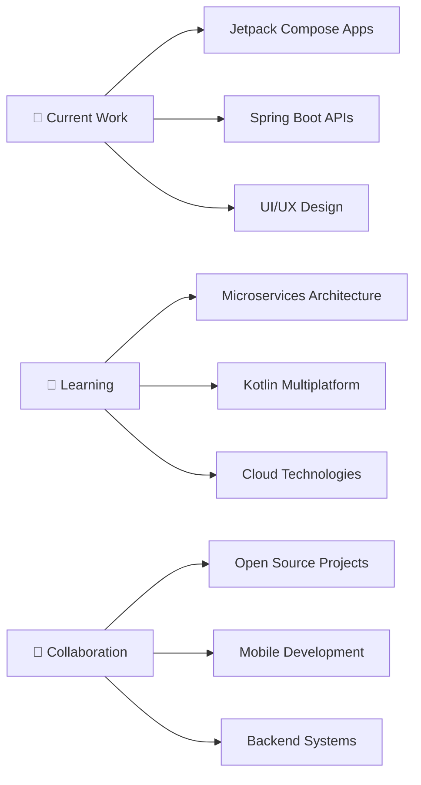

<div align="center">
  
# Hi there, I'm Ahmed Ibrahim 👋


</div>

---

## 🚀 About Me

```kotlin
val developer = Developer(
    name = "Ahmed Ibrahim",
    location = "Egypt 🇪🇬",
    education = "Mathematics & Computer Science",
    currentFocus = listOf("Android Development", "Backend Systems", "UI/UX Design"),
    funFact = "I love solving complex problems with elegant code! ⚡"
)
```

I'm passionate about building **modern**, **scalable**, and **user-friendly** applications. With a strong foundation in **Mathematics & Computer Science**, I specialize in **Android development** using cutting-edge technologies and **Backend systems** that power great user experiences.

---

## 🛠️ Tech Arsenal

<div align="center">

### 📱 Mobile Development


### 🔧 Backend Development


### 🗄️ Databases & Cloud


### 🎨 Design & Tools


</div>

---

## 🌟 Featured Projects

<div align="center">

<table>
<tr>
<td width="50%">

### ✈️ Flight Booking App
**Modern flight booking solution**
- Real-time flight search & comparison
- Intuitive booking flow
- Payment gateway integration
- Material Design 3 UI

`Kotlin` `Jetpack Compose` `MVVM` `REST API`

</td>
<td width="50%">

### 🛒 E-Commerce Platform
**Complete shopping experience**
- Product catalog with filters
- Shopping cart & wishlist
- Secure payment processing
- Admin dashboard

`Android` `Spring Boot` `MySQL` `Firebase`

</td>
</tr>
<tr>
<td width="50%">

### 📚 Classroom Management
**Educational system solution**
- Course & student management
- Scheduling system
- Grade tracking
- Communication tools

`Laravel` `PHP` `MySQL` `Bootstrap`

</td>
<td width="50%">

### 📖 Quran Reader App
**Islamic mobile application**
- Smooth Arabic text rendering
- Bookmark & search features
- Audio recitation support
- Beautiful Islamic UI/UX

`Kotlin` `Room Database` `Custom Views`

</td>
</tr>
</table>

</div>

<div align="center">

[](https://github.com/Ahmed01088?tab=repositories)

</div>

---

## 📊 GitHub Analytics

<div align="center">


</div>

---

## 🎯 Current Focus & Goals

<div align="center">



</div>

---

## 🏆 GitHub Trophies

<div align="center">


</div>

---

## 💼 Professional Experience

<div align="center">

| 🎓 **Education** | 📱 **Mobile Development** | 🔧 **Backend Systems** | 🎨 **UI/UX Design** |
|:---:|:---:|:---:|:---:|
| Mathematics & CS | 3+ Years Experience | Spring Boot & Laravel | Adobe Creative Suite |
| Problem Solving | Kotlin & Java Expert | Database Design | Modern UI Patterns |
| Algorithm Design | Android Architecture | RESTful APIs | User Experience Focus |

</div>

---

## 🤝 Let's Connect & Collaborate

<div align="center">

[](https://www.linkedin.com/in/ahmed-ibrahim-466a05287)
[](https://github.com/Ahmed01088)
[](mailto:ahmed.ibrahim@example.com)
[](https://your-portfolio.com)

**📧 Open for:** Freelance Projects | Full-time Opportunities | Collaboration | Mentoring

</div>

---

## 🎨 Activity Graph

<div align="center">


</div>

---

<div align="center">

### 💡 *"Code is like humor. When you have to explain it, it's bad."* – Cory House


---

**⚡ Fun fact:** I can debug code faster with a cup of coffee ☕ and some good music 🎵!


</div>
