<div align="center">
  
# Hi there, I'm Ahmed Ibrahim 👋


<p>


<a href="#-featured-projects-showcase"></a>
</p>

<p>
<b>Android &amp; iOS developer — 31 apps live on Google Play.</b><br>
I build whole platforms rather than single apps: the customer app, the merchant app and the courier app,<br>
with the dashboard and API behind them — Arabic-first, full RTL.
</p>

<p>
<a href="#-featured-projects-showcase"><b>↓ See the apps</b></a> ·
<a href="#-about-me">About</a> ·
<a href="#-tech-stack--expertise">Tech Stack</a> ·
<a href="#-development-journey--roadmap">Roadmap</a> ·
<a href="#-professional-services--expertise">Services</a> ·
<a href="#-lets-connect--build-the-future-together">Contact</a>
</p>

</div>

---

## 🌟 About Me

<div align="center">


<table border="0" cellpadding="25" cellspacing="0">
<tr>
<td width="50%" valign="top">

<div align="left">

### 👨‍💻 **Who Am I?**


> 💡 **Passionate Mobile Developer** from Egypt 🇪🇬  
> 🎓 **Mathematics & Computer Science Graduate**  
> 🚀 **Specialized in Android & iOS Development**  
> 📱 **Kotlin & Java Enthusiast**  


### 🎯 **What Drives Me?**

```yaml
passions:
  innovation: "🔮 Exploring cutting-edge mobile technologies"
  architecture: "🏗️ Building scalable cross-platform solutions"
  design: "🎨 Crafting beautiful user experiences"
  collaboration: "🤝 Working with amazing teams"
  learning: "📚 Continuous skill development"
```

### 🌟 **Core Values**

<div>

- **🔥 Quality First** → Writing clean, maintainable code
- **⚡ Performance Focused** → Optimized, efficient solutions  
- **🎨 User-Centric** → Intuitive, accessible design
- **📚 Growth Mindset** → Always learning, always improving
- **🤝 Team Player** → Collaborative problem solving

</div>

</div>

</td>
<td width="50%" valign="top">

<div align="center">


<br><br>

### 📊 **GitHub Analytics**

<div>


</div>

### ⚡ **Developer Insights**

<div align="left">

```javascript
const ahmed = {
  coffee: "☕ Essential fuel for coding",
  superpower: "🐛 Bug detection at 3 AM",
  philosophy: "💭 Code is poetry in logic",
  motto: "✨ Turning ideas into reality",
  workflow: "🔄 Test, Build, Deploy, Repeat"
};
```

</div>

</div>

</td>
</tr>
</table>


</div>

---

## 🚀 Tech Stack & Expertise

<div align="center">

### 📱 **Mobile Development Excellence**
<div>


<br><br>

)
)
)
)
)
)
)
)
)

</div>

### ⚙️ **Backend Development**
<div>


<br><br>

)
)
)
)

</div>

### 🗄️ **Database & Cloud Solutions**
<div>


<br><br>

)
)
)
)
)

</div>

### 🎨 **Design & Development Tools**
<div>


<br><br>

)
)
)
)

</div>

</div>

---

## 🌟 Featured Projects Showcase

<div align="center">


### 🚀 **Published Apps on Google Play Store**

Every poster below uses real in-app screens — no stock mockups. Click a poster to open it full size.

<table>
<tr><td>

**🛵 Delivery & logistics**  
[Tasahel Express](https://play.google.com/store/apps/details?id=apps.projectegy.tasahel_captain) ·
[Wasela](https://play.google.com/store/apps/details?id=apps.projectegy.wasela_client) ·
[Wasela Store](https://play.google.com/store/apps/details?id=apps.projecteg.waselastore) ·
[Wasela Captain](https://play.google.com/store/apps/details?id=apps.projectegy.deliveryegyptcaptain) ·
[ALAMRO Captain](https://play.google.com/store/apps/details?id=apps.projectegy.elamr_captain) ·
[Rocket Cargo](https://play.google.com/store/apps/details?id=apps.captainrocketcargo) ·
[SheDrive Driver](https://play.google.com/store/apps/details?id=apps.projectegy.shedrivedriver)

**🛒 Commerce & marketplaces**  
[Al Asdiqaa](https://play.google.com/store/apps/details?id=apps.elasdiqa) ·
[Hadaya](https://play.google.com/store/apps/details?id=apps.projecteg.hadaya) ·
[Farda Gomla](https://play.google.com/store/apps/details?id=apps.farda) ·
[Marvel Cosmetics](https://play.google.com/store/apps/details?id=apps.marvel) ·
[30 MIN](https://play.google.com/store/apps/details?id=apps.shasha_bagha) ·
[Itqan Horeca](https://play.google.com/store/apps/details?id=apps.projectegy.itqaanapp)

**🍽️ Food & restaurants**  
[Lucinda Oasis](https://play.google.com/store/apps/details?id=apps.lucinda_oasis) ·
[Emdad](https://play.google.com/store/apps/details?id=apps.projectegy.emdad) ·
[Makuk](https://play.google.com/store/apps/details?id=apps.projectegy.makuk)

</td><td>

**🎓 Education**  
[Academoz](https://play.google.com/store/apps/details?id=apps.academoz) ·
[MaxWell](https://play.google.com/store/apps/details?id=app.maxwell) ·
[Ways](https://play.google.com/store/apps/details?id=app.elzatoona) ·
[Kedu](https://play.google.com/store/apps/details?id=game.projectegy.kedu) ·
[Concrete Engineering](https://play.google.com/store/apps/details?id=apps.concret)

**🏥 Health & services**  
[Medi Care](https://play.google.com/store/apps/details?id=apps.projecteg.medicare) ·
[Home Fix](https://play.google.com/store/apps/details?id=apps.projectegy.homefix) ·
[Yalla Style](https://play.google.com/store/apps/details?id=apps.yallastyle_provider) ·
[G4FIT](https://play.google.com/store/apps/details?id=apps.projecteg.g4fit)

**🏗️ Business & directories**  
[Rakaez](https://play.google.com/store/apps/details?id=apps.rakaez.client) ·
[BNB Dafatery](https://play.google.com/store/apps/details?id=apps.bnb) ·
[Egypt Online](https://play.google.com/store/apps/details?id=apps.egyptonline) ·
[EGO](https://play.google.com/store/apps/details?id=projectegy.ego)

**✈️ Travel & faith**  
[TAS Travel](https://play.google.com/store/apps/details?id=com.game.tastravel) ·
[Khatma](https://play.google.com/store/apps/details?id=com.khatma)

</td></tr>
</table>

<table>
<tr>
<td width="50%" align="center">

<div>

### 🎓 **Academoz - Educational Platform**
*Comprehensive learning platform connecting students with quality education*

<a href="assets/posters/academoz.png"></a>

**🔧 Technology Stack:**  
`Kotlin` `Java` `Jetpack Compose` `MVVM` `Firebase` `Material Design 3`

**✨ Key Features:**  
📚 Comprehensive course catalog  
🎥 Video streaming integration  
📊 Progress tracking & analytics  
💬 Interactive learning tools  

<br>

[](https://play.google.com/store/apps/details?id=apps.academoz)

</div>

</td>
<td width="50%" align="center">

<div>

### 🛒 **Al Asdiqaa — الأصدقاء**
*Online supermarket with branch-aware stock and home delivery*

<a href="assets/posters/asdiqaa.png">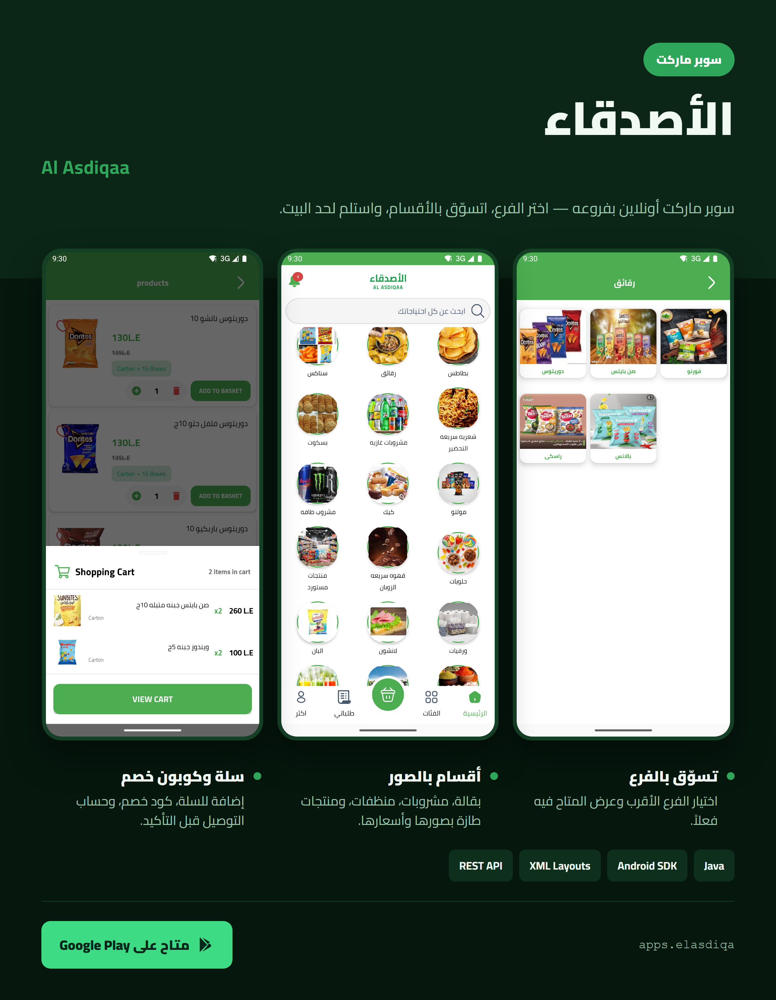</a>

**🔧 Technology Stack:**  
`Java` `Android SDK` `XML Layouts` `REST API`

**✨ Key Features:**  
🏬 Pick your nearest branch  
🧺 Categories with real product photos  
🎟️ Cart, discount codes and delivery fees  
🚚 Order tracking to the door  

<br>

[](https://play.google.com/store/apps/details?id=apps.elasdiqa)

</div>

</td>
</tr>
<tr>
<td width="50%" align="center">

<div>

### 🍽️ **Lucinda Oasis Restaurant**
*Modern restaurant ordering app with seamless payment integration*

<a href="assets/posters/lucinda.png"></a>

**🔧 Technology Stack:**  
`Kotlin` `Jetpack Compose` `MVVM` `Firebase` `Stripe Payment`

**✨ Key Features:**  
🍔 Dynamic menu with images  
🛒 Smart cart management  
💳 Secure payment gateway (Stripe)  
📍 Location-based services  
🔔 Real-time order notifications  

<br>

[](https://play.google.com/store/apps/details?id=apps.lucinda_oasis)

</div>

</td>
<td width="50%" align="center">

<div>

### ✈️ **TAS Travel - Flight Booking**
*Complete travel booking solution with real-time flight search*

<a href="assets/posters/tastravel.png"></a>

**🔧 Technology Stack:**  
`Kotlin` `Compose Multiplatform` `MVVM` `REST API` `Ktor`

**✨ Key Features:**  
🔍 Advanced flight search & filters  
✈️ Multi-city booking support  
💼 Booking history & management  
🎫 Digital ticket storage  
🌍 Multi-currency support  

<br>

[](https://play.google.com/store/apps/details?id=com.game.tastravel)

</div>

</td>
</tr>
<tr>
<td width="50%" align="center">

<div>

### 🏥 **Medi Care — ميدي كير**
*Medical care membership with discounts across partner clinics and labs*

<a href="assets/posters/medicare.png"></a>

**🔧 Technology Stack:**  
`Java` `Android SDK` `XML Layouts` `REST API` `Material Design`

**✨ Key Features:**  
🏷️ Discounts of up to 70% on partner services  
🗺️ Governorate and district coverage picker  
👤 Membership registration & renewal  
👁️ Guest browsing before sign-up  

<br>

[](https://play.google.com/store/apps/details?id=apps.projecteg.medicare)

</div>

</td>
<td width="50%" align="center">

<div>

### 🛠️ **Home Fix — هوم فيكس**
*On-demand home maintenance: request a technician, track the visit*

<a href="assets/posters/homefix.png"></a>

**🔧 Technology Stack:**  
`Kotlin` `Compose Multiplatform` `MVVM` `Ktor` `Koin`

**✨ Key Features:**  
🧰 Service catalog by trade  
📅 Visit scheduling & status tracking  
📍 Address book with map selection  
🌐 Arabic / English with full RTL  

<br>

[](https://play.google.com/store/apps/details?id=apps.projectegy.homefix)

</div>

</td>
</tr>
<tr>
<td width="50%" align="center">

<div>

### 🎁 **Hadaya — هدايا**
*Gift shopping and delivery with occasion-based browsing*

<a href="assets/posters/hadaya.png"></a>

**🔧 Technology Stack:**  
`Java` `Android SDK` `XML Layouts` `Firebase` `REST API`

**✨ Key Features:**  
🎀 Catalog organised by occasion  
🛒 Cart with gift notes  
🔔 Firebase push notifications  
🚚 Order tracking to delivery  

<br>

[](https://play.google.com/store/apps/details?id=apps.projecteg.hadaya)

</div>

</td>
<td width="50%" align="center">

<div>

### 🛵 **Tasahel Express — تساهيل إكسبريس**
*Courier app for assigning, running and closing delivery trips*

<a href="assets/posters/tasahel.png"></a>

**🔧 Technology Stack:**  
`Kotlin` `Compose Multiplatform` `MVVM` `Ktor` `Google Maps`

**✨ Key Features:**  
📦 Trip queue with accept / reject  
🗺️ Navigation to pickup and drop-off  
💵 Cash-on-delivery reconciliation  
📈 Earnings and trip history  

<br>

[](https://play.google.com/store/apps/details?id=apps.projectegy.tasahel_captain)

</div>

</td>
</tr>
<tr>
<td width="50%" align="center">

<div>

### 🚚 **Captain Rocket Cargo**
*Driver app for freight pickups, loads and proof of delivery*

<a href="assets/posters/rocketcargo.png"></a>

**🔧 Technology Stack:**  
`Java` `Android SDK` `XML Layouts` `REST API` `Google Maps`

**✨ Key Features:**  
🧾 Shipment list with load details  
📍 Live route to pickup and delivery  
📷 Proof-of-delivery capture  
🕒 Status updates per leg  

<br>

[](https://play.google.com/store/apps/details?id=apps.captainrocketcargo)

</div>

</td>
<td width="50%" align="center">

<div>

### 🏗️ **Rakaez — ركائز**
*Construction project tracking for clients following their build*

<a href="assets/posters/rakaez.png"></a>

**🔧 Technology Stack:**  
`Kotlin` `Jetpack Compose` `MVVM` `REST API` `Material Design 3`

**✨ Key Features:**  
📊 Stage-by-stage progress view  
🖼️ Site photo updates per milestone  
📄 Documents and contract access  
🔔 Progress notifications  

<br>

[](https://play.google.com/store/apps/details?id=apps.rakaez.client)

</div>

</td>
</tr>
<tr>
<td width="50%" align="center">

<div>

### 📒 **BNB Dafatery — دفاتري**
*Ledger app for merchants: customers, transactions and instalments*

<a href="assets/posters/bnb.png">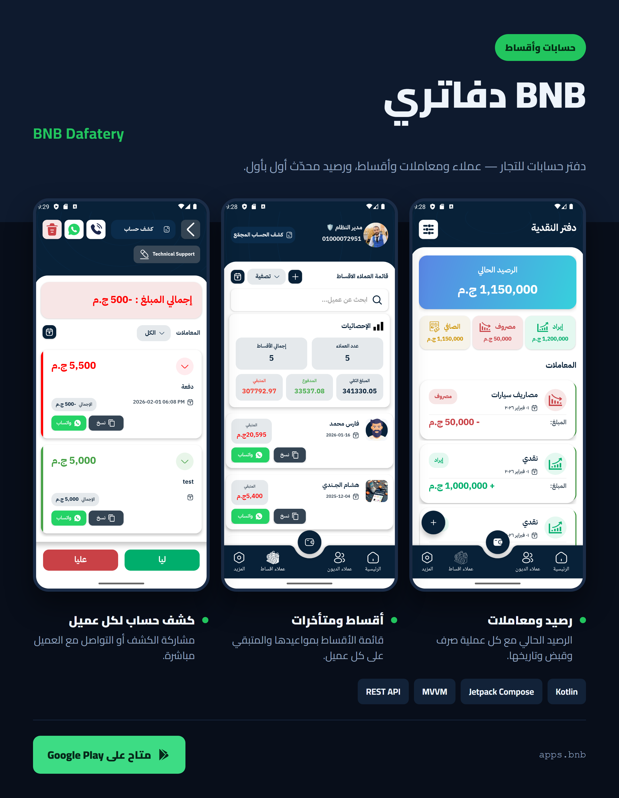</a>

**🔧 Technology Stack:**  
`Kotlin` `Jetpack Compose` `MVVM` `REST API`

**✨ Key Features:**  
💰 Live balance with every credit and debit  
📆 Instalment schedule and arrears per customer  
🧾 Shareable statement per customer  
📊 Totals for paid, due and outstanding  

<br>

[](https://play.google.com/store/apps/details?id=apps.bnb)

</div>

</td>
<td width="50%" align="center">

<div>

### 🧒 **Kedu — كيدو**
*Educational game for kids with unlocking levels, in Arabic and English*

<a href="assets/posters/kedu.png">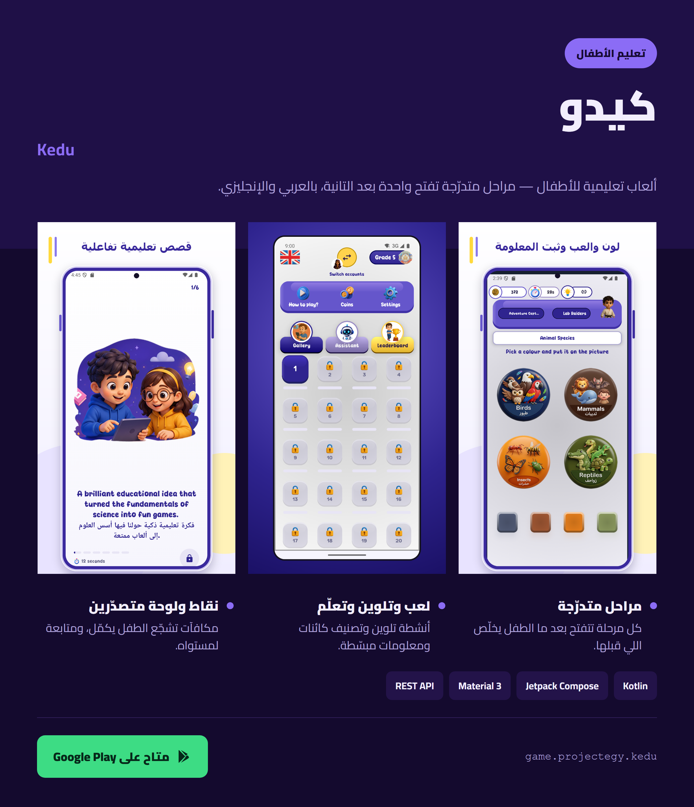</a>

**🔧 Technology Stack:**  
`Kotlin` `Jetpack Compose` `Material 3` `REST API`

**✨ Key Features:**  
🔓 Levels that unlock one after another  
🎨 Colour, sort and learn activities  
🏆 Points and a leaderboard  
🌍 Arabic and English content  

<br>

[](https://play.google.com/store/apps/details?id=game.projectegy.kedu)

</div>

</td>
</tr>
<tr>
<td width="50%" align="center">

<div>

### 📰 **Egypt Online**
*Classifieds and services — property, cars, electronics and more*

<a href="assets/posters/egyptonline.png">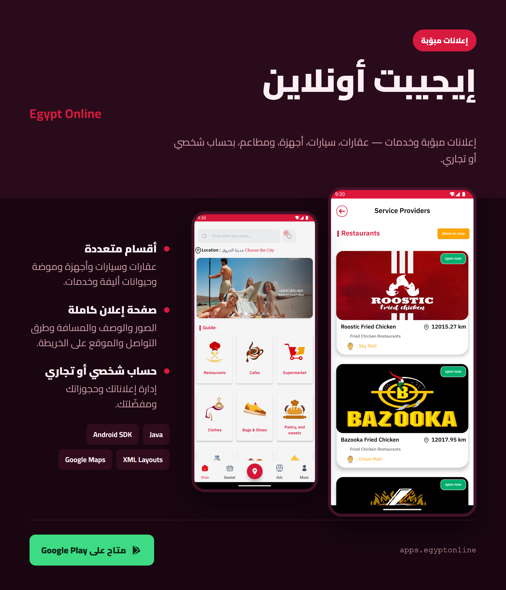</a>

**🔧 Technology Stack:**  
`Java` `Android SDK` `XML Layouts` `Google Maps`

**✨ Key Features:**  
🏷️ Property, cars, devices, fashion and pets  
📸 Full listing pages with photos and distance  
🗺️ Map location and direct contact  
👤 Personal or business accounts  

<br>

[](https://play.google.com/store/apps/details?id=apps.egyptonline)

</div>

</td>
<td width="50%" align="center">

<div>

### 🛵 **ALAMRO Captain — العمرو كابتن**
*Courier app: active orders, settlement and wallet*

<a href="assets/posters/elamr.png">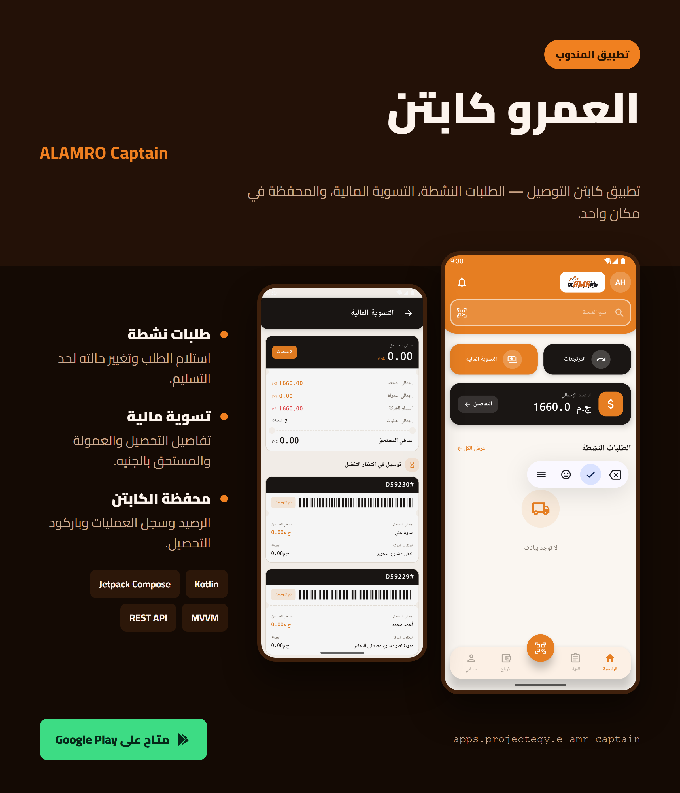</a>

**🔧 Technology Stack:**  
`Kotlin` `Jetpack Compose` `MVVM` `REST API`

**✨ Key Features:**  
📦 Active orders with status changes  
💵 Financial settlement and commission  
👛 Courier wallet and collection barcode  
🧾 Per-trip earnings history  

<br>

[](https://play.google.com/store/apps/details?id=apps.projectegy.elamr_captain)

</div>

</td>
</tr>
<tr>
<td width="50%" align="center">

<div>

### 👟 **Farda Gomla — فردة جملة**
*Wholesale footwear at factory prices*

<a href="assets/posters/farda.png">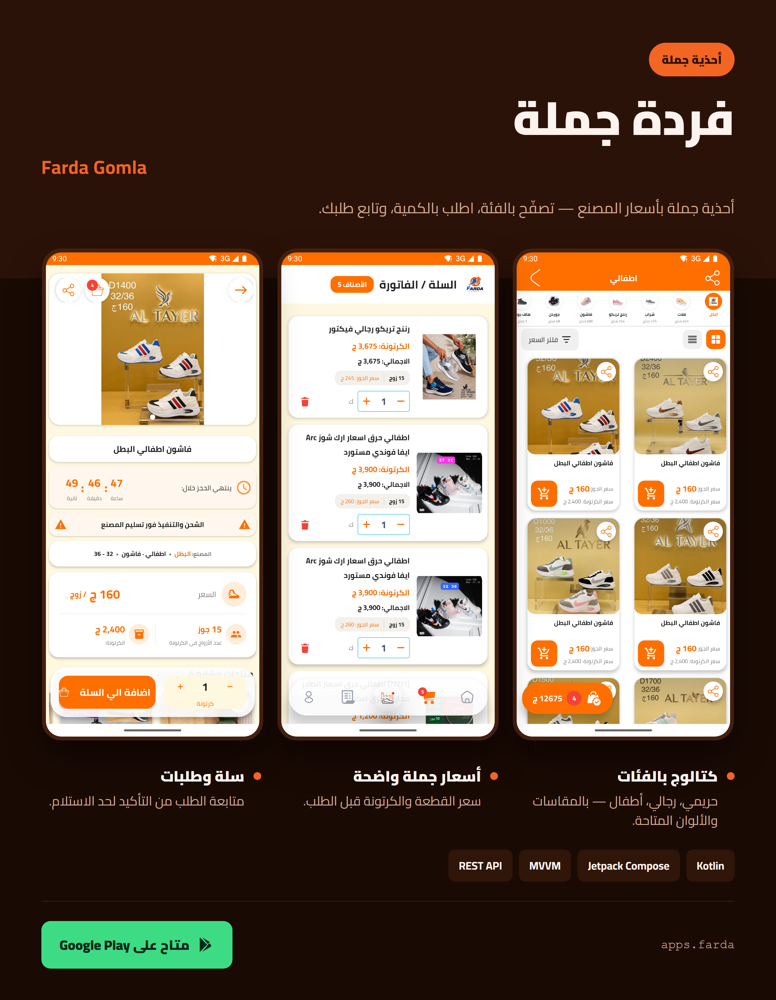</a>

**🔧 Technology Stack:**  
`Kotlin` `Jetpack Compose` `MVVM` `REST API`

**✨ Key Features:**  
👞 Women's, men's and kids' catalogues  
📐 Sizes and colours per model  
💵 Clear per-piece and per-carton pricing  
🚚 Order tracking to delivery  

<br>

[](https://play.google.com/store/apps/details?id=apps.farda)

</div>

</td>
<td width="50%" align="center">

<div>

### 💄 **Marvel Cosmetics — مارفل**
*Cosmetics and personal care store with original brands*

<a href="assets/posters/marvel.png">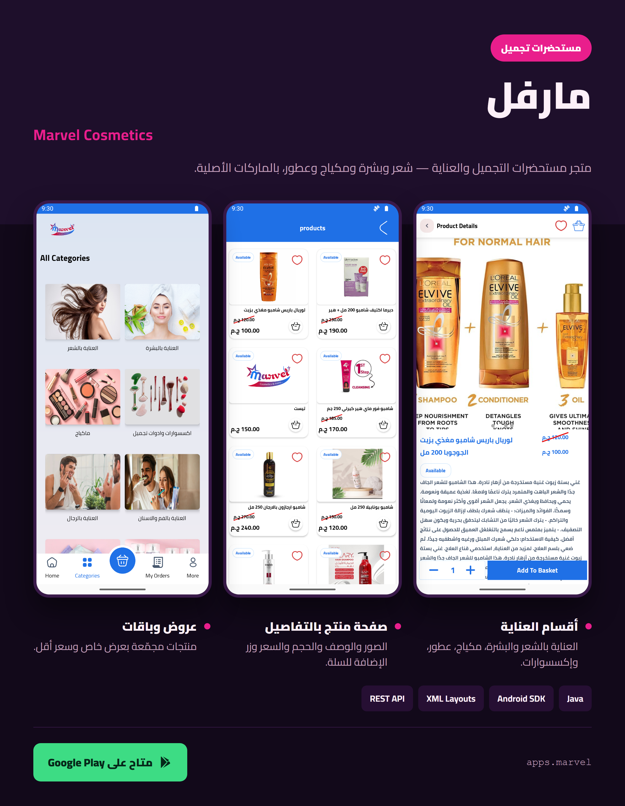</a>

**🔧 Technology Stack:**  
`Java` `Android SDK` `XML Layouts` `REST API`

**✨ Key Features:**  
💇 Hair care, skin care, make-up and fragrance  
🧴 Product pages with size, description and price  
🎁 Bundles and discounted sets  
🛒 Cart, favourites and order history  

<br>

[](https://play.google.com/store/apps/details?id=apps.marvel)

</div>

</td>
</tr>
<tr>
<td width="50%" align="center">

<div>

### 📱 **30 MIN — 30 دقيقة**
*Phone accessories and repairs, promised in thirty minutes*

<a href="assets/posters/min30.png">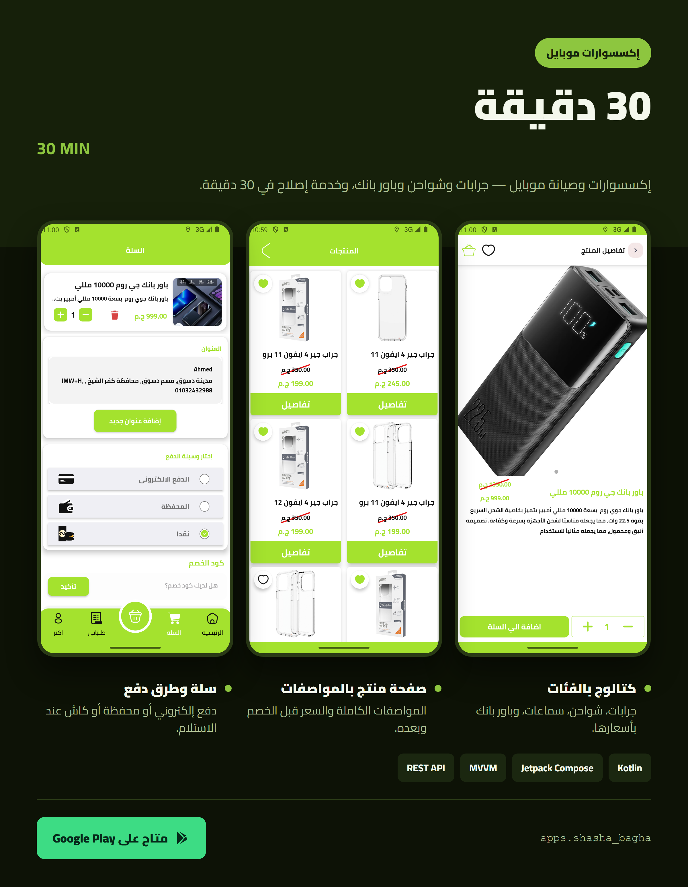</a>

**🔧 Technology Stack:**  
`Kotlin` `Jetpack Compose` `MVVM` `REST API`

**✨ Key Features:**  
🔌 Cases, chargers, audio and power banks  
📋 Full specs with before/after pricing  
🧰 Repair service booking  
💳 Card, wallet or cash on delivery  

<br>

[](https://play.google.com/store/apps/details?id=apps.shasha_bagha)

</div>

</td>
<td width="50%" align="center">

<div>

### ✂️ **Yalla Style Provider — يلا ستايل**
*Barbershop provider app: bookings, services and earnings*

<a href="assets/posters/yallastyle.png">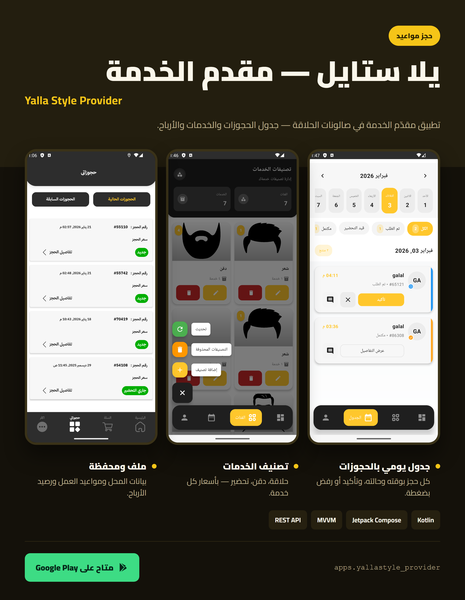</a>

**🔧 Technology Stack:**  
`Kotlin` `Jetpack Compose` `MVVM` `REST API`

**✨ Key Features:**  
📅 Daily schedule with confirm / reject  
💈 Service catalogue with per-service pricing  
🏪 Shop profile and working hours  
👛 Earnings wallet  

<br>

[](https://play.google.com/store/apps/details?id=apps.yallastyle_provider)

</div>

</td>
</tr>
<tr>
<td width="50%" align="center">

<div>

### ☕ **Itqan Horeca — إتقان**
*HoReCa supply: coffee, beverages and raw materials for restaurants and hotels*

<a href="assets/posters/itqaan.png">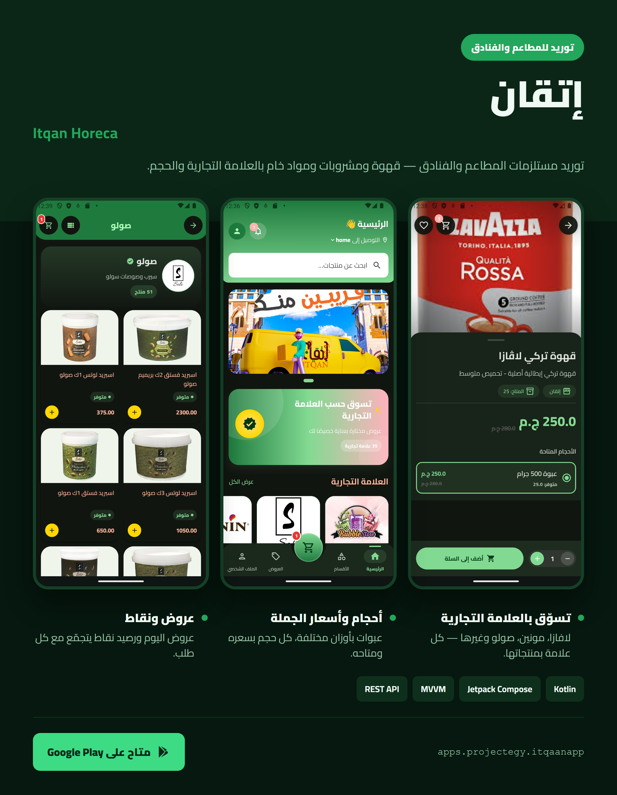</a>

**🔧 Technology Stack:**  
`Kotlin` `Jetpack Compose` `MVVM` `REST API`

**✨ Key Features:**  
🏷️ Shop by brand — Lavazza, Monin, Solo and more  
⚖️ Pack sizes with wholesale pricing and stock  
🎁 Daily offers and a points balance  
🧾 Order history and saved addresses  

<br>

[](https://play.google.com/store/apps/details?id=apps.projectegy.itqaanapp)

</div>

</td>
<td width="50%" align="center">

<div>

### 📖 **Khatma — ختمة**
*Offline Mushaf with voice recitation check, adhkar and prayer times*

<a href="assets/posters/khatma.png">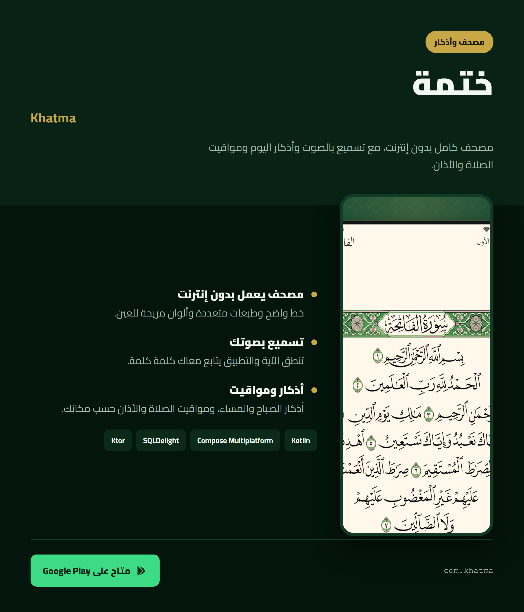</a>

**🔧 Technology Stack:**  
`Kotlin` `Compose Multiplatform` `SQLDelight` `Ktor`

**✨ Key Features:**  
📵 Full Mushaf that works with no internet  
🎙️ Recite aloud and the app follows word by word  
🤲 Morning and evening adhkar  
🕌 Prayer times and adhan for your location  

<br>

[](https://play.google.com/store/apps/details?id=com.khatma)

</div>

</td>
</tr>
<tr>
<td width="50%" align="center">

<div>

### 🍽️ **Emdad — إمداد**
*Multi-restaurant marketplace with menus, delivery and flexible payment*

<a href="assets/posters/emdad.png">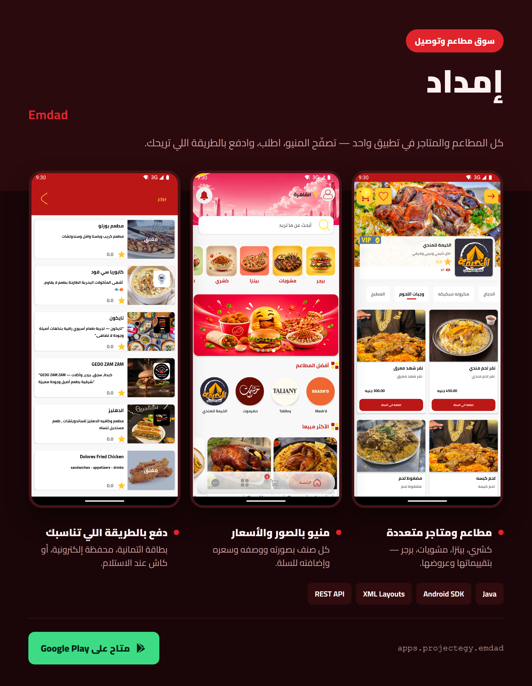</a>

**🔧 Technology Stack:**  
`Java` `Android SDK` `XML Layouts` `REST API`

**✨ Key Features:**  
🍔 Many restaurants and stores in one app  
📸 Menus with photos, descriptions and prices  
⭐ Ratings, offers and best sellers  
💳 Card, e-wallet or cash on delivery  

<br>

[](https://play.google.com/store/apps/details?id=apps.projectegy.emdad)

</div>

</td>
<td width="50%" align="center">

<div>

### 🚗 **SheDrive Driver — شي درايف**
*Driver app for a women-only ride service*

<a href="assets/posters/shedrive.png">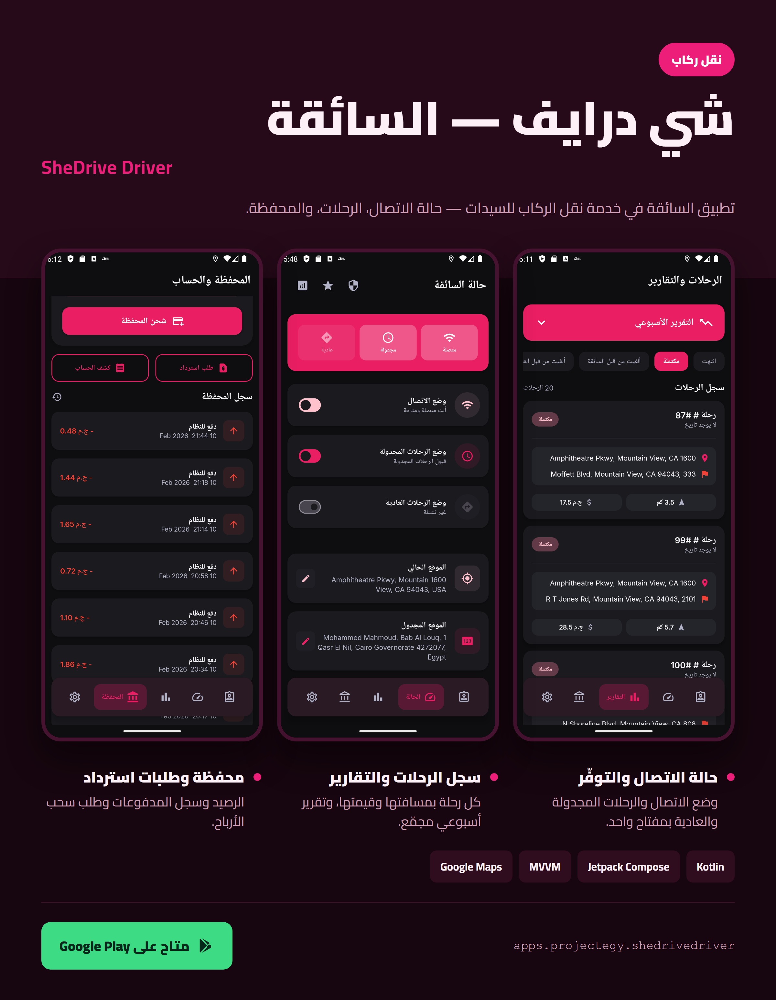</a>

**🔧 Technology Stack:**  
`Kotlin` `Jetpack Compose` `MVVM` `Google Maps`

**✨ Key Features:**  
🟢 Online, scheduled and regular ride modes  
🗺️ Trip log with distance and fare per ride  
📊 Weekly earnings report  
👛 Wallet with payout requests  

<br>

[](https://play.google.com/store/apps/details?id=apps.projectegy.shedrivedriver)

</div>

</td>
</tr>
<tr>
<td width="50%" align="center">

<div>

### 🏗️ **Concrete Engineering Services**
*Online engineering school: structural design courses and diplomas*

<a href="assets/posters/concret.png">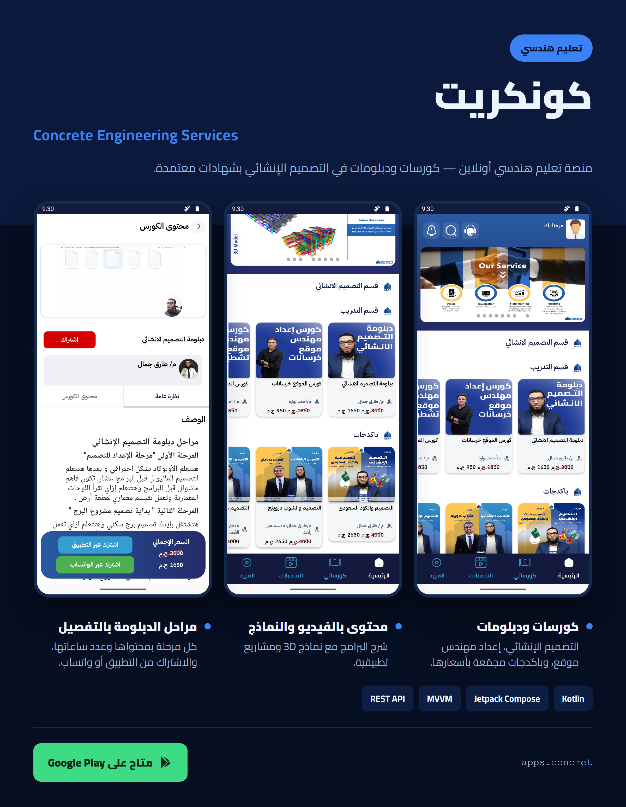</a>

**🔧 Technology Stack:**  
`Kotlin` `Jetpack Compose` `MVVM` `REST API`

**✨ Key Features:**  
🎓 Courses, diplomas and bundled packages  
🧱 Video lessons with 3D models and real projects  
📋 Diploma stages with hours and content  
💬 Enrol in-app or over WhatsApp  

<br>

[](https://play.google.com/store/apps/details?id=apps.concret)

</div>

</td>
<td width="50%" align="center">

<div>

### 🏭 **EGO — دليل المصانع والشركات**
*Industrial directory of Egyptian factories, companies and suppliers*

<a href="assets/posters/ego.png">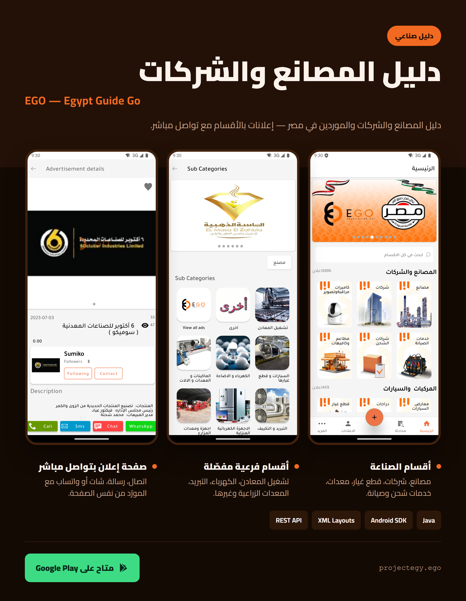</a>

**🔧 Technology Stack:**  
`Java` `Android SDK` `XML Layouts` `REST API`

**✨ Key Features:**  
🏷️ Factories, companies, spare parts and equipment  
🗂️ Detailed sub-categories per industry  
📞 Call, SMS, chat or WhatsApp from the listing  
📍 Listings on a map with follower counts  

<br>

[](https://play.google.com/store/apps/details?id=projectegy.ego)

</div>

</td>
</tr>
<tr>
<td width="50%" align="center">

<div>

### 🏋️ **G4FIT**
*Gym memberships and personal training with session packages*

<a href="assets/posters/g4fit.png">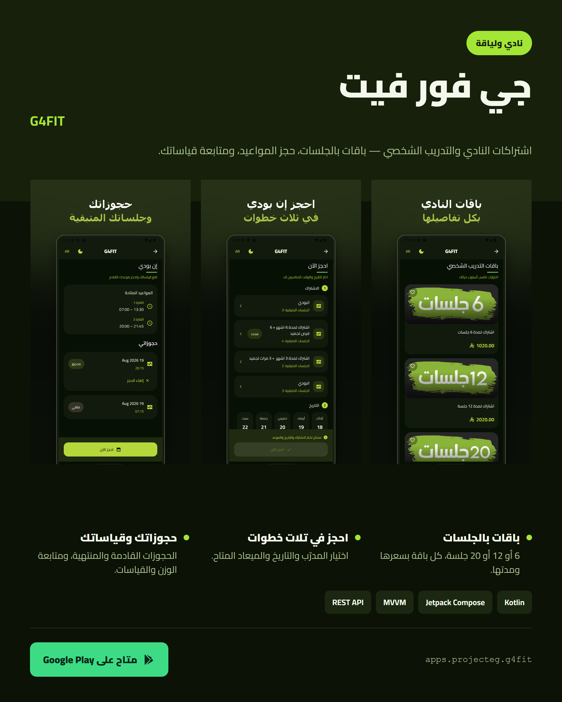</a>

**🔧 Technology Stack:**  
`Kotlin` `Jetpack Compose` `MVVM` `REST API`

**✨ Key Features:**  
🎟️ 6, 12 or 20 session packages with pricing  
📅 Book in three steps — trainer, date, slot  
📈 Weight and body measurement tracking  
🔔 Club offers and booking reminders  

<br>

[](https://play.google.com/store/apps/details?id=apps.projecteg.g4fit)

</div>

</td>
<td width="50%" align="center">

<div>

### 🛵 **Makuk — مكوك**
*Restaurants and markets in one app, with sizes, extras and offers*

<a href="assets/posters/makuk.png">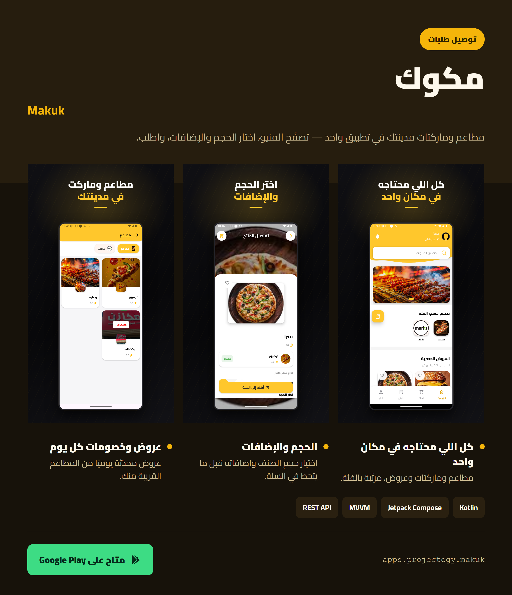</a>

**🔧 Technology Stack:**  
`Kotlin` `Jetpack Compose` `MVVM` `REST API`

**✨ Key Features:**  
🍕 Restaurants and markets grouped by category  
📏 Pick size and extras before adding to cart  
🏷️ Daily offers and discounts  
🗺️ Discover what is open nearby  

<br>

[](https://play.google.com/store/apps/details?id=apps.projectegy.makuk)

</div>

</td>
</tr>
<tr>
<td width="50%" align="center">

<div>

### 📚 **MaxWell — ماكسويل**
*Learning platform for students and parents, with attendance tracking*

<a href="assets/posters/maxwell.png">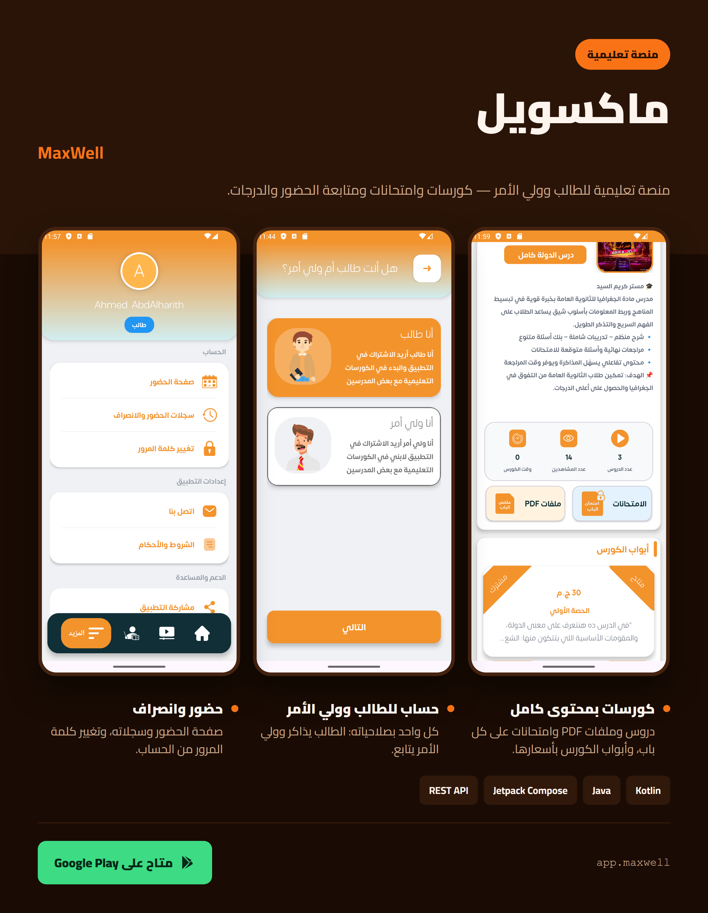</a>

**🔧 Technology Stack:**  
`Kotlin` `Java` `Jetpack Compose` `REST API`

**✨ Key Features:**  
🎥 Lessons, PDF summaries and per-chapter exams  
👨‍👩‍👦 Separate student and parent accounts  
🗓️ Attendance page and full records  
📊 Visual stats for teachers, courses and exams  

<br>

[](https://play.google.com/store/apps/details?id=app.maxwell)

</div>

</td>
<td width="50%" align="center">

<div>

### 🎓 **Ways**
*Learning platform with video lessons, summaries and practice*

<a href="assets/posters/ways.png">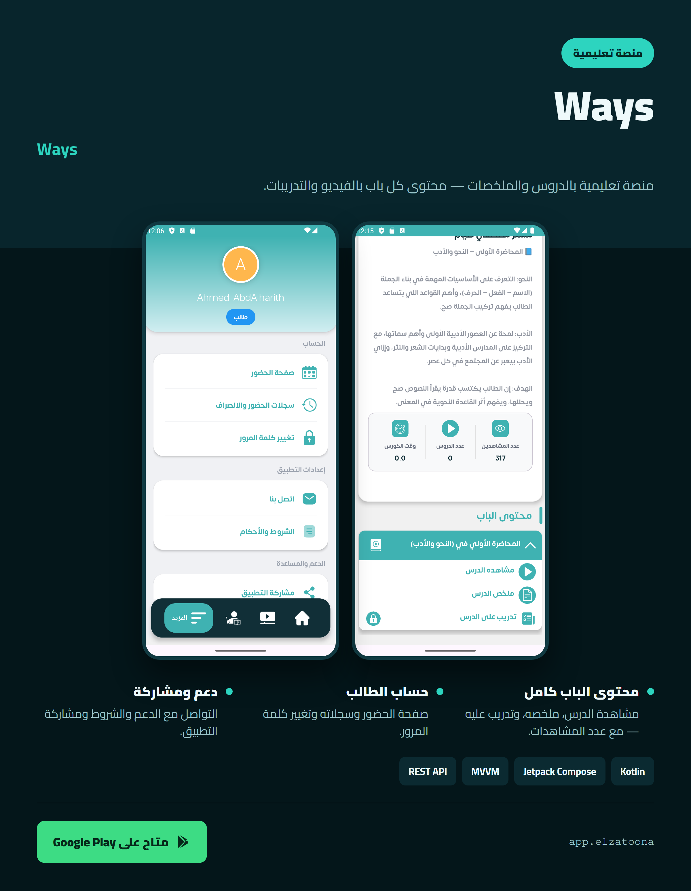</a>

**🔧 Technology Stack:**  
`Kotlin` `Jetpack Compose` `MVVM` `REST API`

**✨ Key Features:**  
📖 Watch the lesson, read the summary, practise on it  
👁️ View counts and course duration per chapter  
🗓️ Attendance page and records  
🔐 Password change and in-app support  

<br>

[](https://play.google.com/store/apps/details?id=app.elzatoona)

</div>

</td>
</tr>
<tr>
<td width="50%" align="center">

<div>

### 📦 **Wasela — وسيلة**
*Order anything: purchases, parcels, errands and rides, with captains bidding on your price*

<a href="assets/posters/waselaclient.png">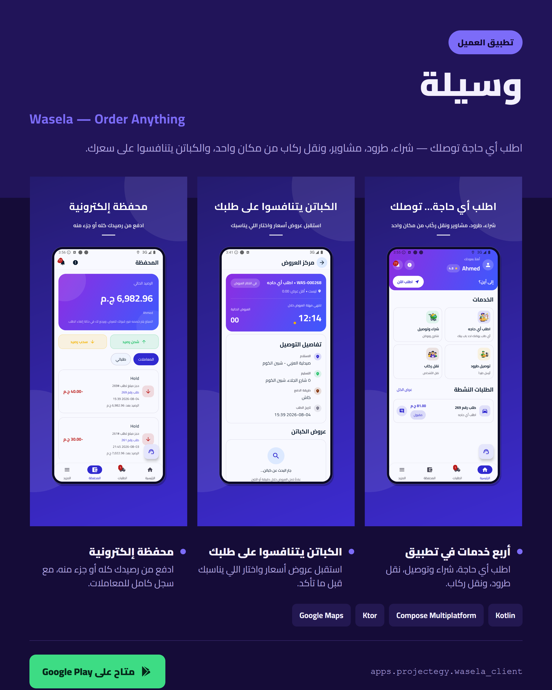</a>

**🔧 Technology Stack:**  
`Kotlin` `Compose Multiplatform` `Ktor` `Google Maps`

**✨ Key Features:**  
🧩 Four services in one app — anything, shopping, parcels, rides  
💸 Captains bid and you pick the offer that suits you  
👛 E-wallet, pay all or part from your balance  
📍 Live order tracking with pickup and drop-off  

<br>

[](https://play.google.com/store/apps/details?id=apps.projectegy.wasela_client)

</div>

</td>
<td width="50%" align="center">

<div>

### 🏪 **Wasela Store — متجر وسيلة**
*A delivery fleet on demand for your shop, with per-order tracking and accounts*

<a href="assets/posters/waselastore.png">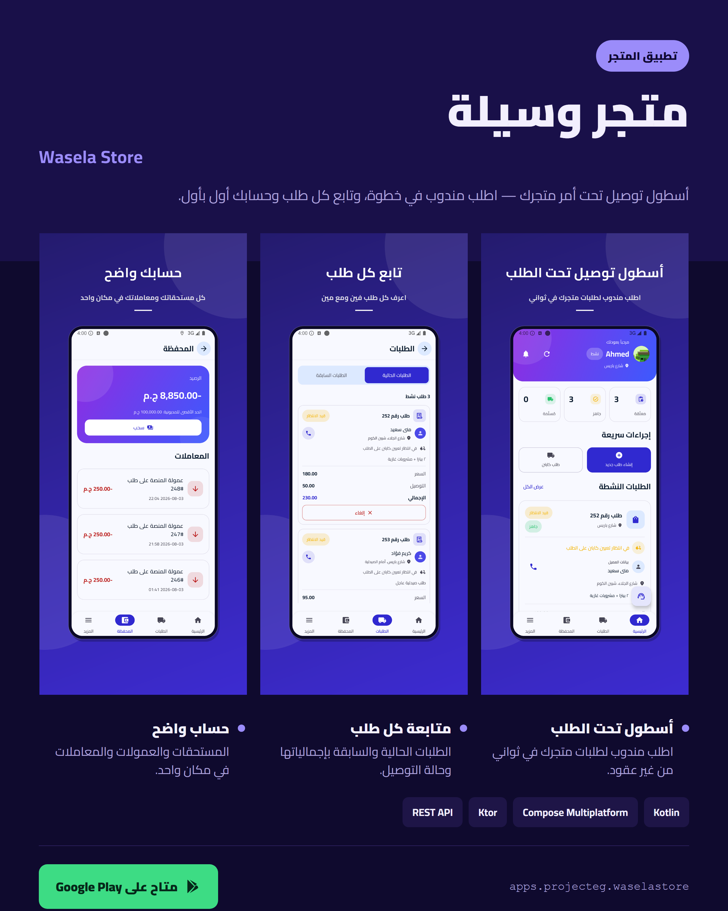</a>

**🔧 Technology Stack:**  
`Kotlin` `Compose Multiplatform` `Ktor` `REST API`

**✨ Key Features:**  
🛵 Request a courier for a shop order in one step  
📋 Current and past orders with totals and status  
🧮 Dues, commissions and transactions in one place  
🔔 Alerts the moment a courier accepts  

<br>

[](https://play.google.com/store/apps/details?id=apps.projecteg.waselastore)

</div>

</td>
</tr>
<tr>
<td colspan="2" align="center">

<div>

### 🛵 **Wasela Captain — كابتن وسيلة**
*Courier app: area orders, order detail and a wallet with clear collection*

<a href="assets/posters/wasela.png">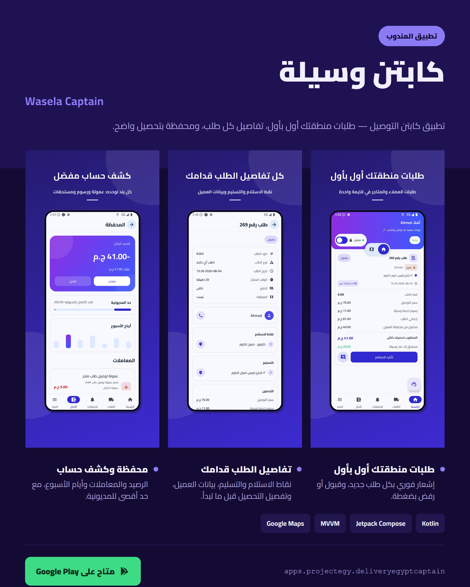</a>

**🔧 Technology Stack:**  
`Kotlin` `Jetpack Compose` `MVVM` `Google Maps`

**✨ Key Features:**  
🔔 Instant alert on every new order in your area  
📍 Pickup and drop-off points with customer details  
💵 Collection breakdown before the trip starts  
👛 Wallet, weekly earnings and a debt ceiling  

<br>

[](https://play.google.com/store/apps/details?id=apps.projectegy.deliveryegyptcaptain)

</div>

</td>
</tr>
</table>

<br>

<div>

[](https://github.com/ahmedabdalharith?tab=repositories)

</div>

</div>

---

### 💻 **Technology Distribution & Expertise**

<div align="center">


<table cellpadding="15">
<tr>
<td width="60%" align="center">

<div>


</div>

</td>
<td width="40%" align="left">

<div>

**🎯 Language Expertise:**

```yaml
primary:
  mobile: "Kotlin, Java"
  cross_platform: "Compose Multiplatform"
  backend: "PHP, Laravel"
  database: "MySQL, SQLite, Room"
  
secondary:
  backend: "Spring Boot, Python"
  patterns: "MVVM, MVP"
  systems: "REST API"
```

**📊 Development Focus:**
- 📱 **50%** Android Development
- 🍎 **20%** iOS (Compose Multiplatform)  
- ⚙️ **20%** Backend Development
- 🎨 **10%** UI/UX & Design

</div>

</td>
</tr>
</table>


</div>

<br><br>

<div>

### 🏆 **Development Achievements & Metrics**


<table cellpadding="20">
<tr>
<td width="25%" align="center">

<div>

**📱 Published Apps**
### 31
*Live on Google Play*

</div>

</td>
<td width="25%" align="center">

<div>

**📦 Public Repositories**
### 18
*On this account*

</div>

</td>
<td width="25%" align="center">

<div>

**🗂️ Product Domains**
### 7
*Delivery to education*

</div>

</td>
<td width="25%" align="center">

<div>

**📅 Building Since**
### 2021
*Android, then KMP*

</div>

</td>
</tr>
</table>

**🎯 Notable Achievements:**
- 🚀 **Published Developer** — 31 apps live on Google Play, every link verified
- 🧩 **Whole Platforms, Not Single Apps** — customer, merchant and courier apps that ship together
- 💡 **Multi-language Developer** — Kotlin, Java and PHP across mobile and backend
- 📱 **Cross-Platform Specialist** — Compose Multiplatform for Android and iOS
- 🌍 **Arabic-First Delivery** — full RTL, Arabic typography and localised content

</div>

### 📈 **Annual Growth Trajectory**

<div align="center">

<div>
<div>


```
2023  Native Android — Java, XML, REST
2024  Publishing at pace — multi-role platforms on Play
2025  Compose Multiplatform — shared Android and iOS code
2026  31 apps live — delivery, commerce, education, health
```

**Current Focus:** 🎯 Compose Multiplatform, realtime order flows, and backend contracts that hold up in production  
**Next Milestone:** ⭐ iOS releases for the Compose Multiplatform apps already shipping on Android

</div>
</div>

</div>

---

## 🎯 Development Journey & Roadmap

<div align="center">


<table>
<tr>
<td width="33%" align="center">

<div>

### 🚀 **Currently Building**


<div align="left">

```yaml
active_projects:
  mobile: "Jetpack Compose Apps"
  ios: "Compose Multiplatform"
  backend: "Laravel API Services"
  architecture: "MVVM & MVP Patterns"
  ui_ux: "Material Design 3"
```

</div>

</div>

</td>
<td width="33%" align="center">

<div>

### 📚 **Learning & Expanding**


<div align="left">

```yaml
skills_development:
  multiplatform: "Kotlin Multiplatform Mobile"
  backend: "Spring Boot Microservices"
  advanced: "Advanced Compose Patterns"
  patterns: "System Design"
  cloud: "AWS & Docker"
```

</div>

</div>

</td>
<td width="33%" align="center">

<div>

### 🎯 **2026 Goals & Vision**


<div align="left">

```yaml
objectives:
  ship: "iOS builds for the KMP apps already live on Android"
  deepen: "Realtime order flows — SignalR, push, offline-first"
  backend: "Laravel & Spring Boot alongside the mobile work"
  contribute: "Open source the shared Compose components"
  mentor: "Arabic-language Android content"
```

</div>

</div>

</td>
</tr>
</table>

### 🛤️ **Professional Evolution Path**

<div>
<div>

**Career Development Roadmap:**


```
🚀 Mobile Developer ─────► 📱 Mobile Architect
⚙️ Backend Developer ────► 👨‍💼 Full-Stack Lead  
💻 Cross-Platform Dev ───► 🎯 Technical Architect
                          │
                          └──► 🌟 Senior Software Architect
```

</div>
</div>

</div>

---

## 🏆 GitHub Achievements & Recognition

<div align="center">

<div>


</div>

### 📊 **Contribution Activity**

<div>


</div>

</div>

---

## 💼 Professional Services & Expertise

<div align="center">


### 🤝 **Available for Collaboration**

<table>
<tr>
<td width="25%" align="center">

<div>


**📱 Android Development**
- Kotlin & Java
- Jetpack Compose & XML
- MVVM & MVP Architecture
- Play Store Publishing

</div>

</td>
<td width="25%" align="center">

<div>


**⚙️ Backend Development**
- Laravel & PHP
- Spring Boot & Java
- RESTful API Design
- Database Optimization

</div>

</td>
<td width="25%" align="center">

<div>


**🌍 Cross-Platform**
- Compose Multiplatform
- Android & iOS Apps
- Shared Business Logic
- App Store Publishing

</div>

</td>
<td width="25%" align="center">

<div>


**🔧 Technical Consulting**
- Code Architecture Review
- Performance Optimization
- Best Practices Training
- Team Leadership

</div>

</td>
</tr>
</table>

### 💰 **Professional Investment Rates**

<div>


| **Service Category** | **Rate Range** | **Expertise Level** | **Delivery Quality** |
|:---:|:---:|:---:|:---:|
| 📱 **Mobile Development** | $18-28/hour | Senior Android | Production Ready |
| ⚙️ **Backend APIs** | $22-35/hour | Laravel & Spring | Scalable Solutions |
| 🌐 **Cross-Platform** | $25-35/hour | Compose KMP | Multi-Platform |
| 🔧 **Technical Leadership** | $30-40/hour | Architecture | Strategic Guidance |

*Rates vary based on project complexity, timeline, and long-term partnership opportunities*

</div>

</div>

---

## 🤝 Let's Connect & Build the Future Together

<div align="center">


### 🌐 **Professional Network & Contact**

<div>

<a href="https://www.linkedin.com/in/ahmed-ibrahim-466a05287" target="_blank">
  
</a>
<a href="https://github.com/ahmedabdalharith" target="_blank">
  
</a>
<a href="mailto:ahmed.alharith01@gmail.com">
  
</a>
<a href="#" target="_blank">
  
</a>
<a href="#" target="_blank">
  
</a>

</div>

### 💼 **Open for New Opportunities**

<table>
<tr>
<td align="center">
<div>
<br>
<strong>Full-Time Positions</strong><br>
<small>Senior Mobile & Backend Roles</small>
</div>
</td>
<td align="center">
<div>
<br>
<strong>Freelance Projects</strong><br>
<small>Custom Mobile & Backend Apps</small>
</div>
</td>
<td align="center">
<div>
<br>
<strong>Open Source</strong><br>
<small>Community Contributions</small>
</div>
</td>
<td align="center">
<div>
<br>
<strong>Mentoring</strong><br>
<small>Code Reviews & Guidance</small>
</div>
</td>
</tr>
</table>

### 🎯 **What I'm Looking For:**

<div>
<div>


- **🚀 Innovative Mobile Projects** pushing boundaries of technology
- **🤝 Collaborative Teams** valuing clean code and best practices  
- **📱 Cross-Platform Companies** building next-gen mobile apps
- **🌍 Global Remote Opportunities** with diverse teams
- **💡 Full-Stack Positions** combining mobile and backend expertise

</div>
</div>

</div>

---

<div align="center">


<div>
<div>


**🌟 Fun Fact:** I've written over 100,000 lines of code this year and I'm just getting started! 🔥

</div>
</div>

<div>


</div>

<br>

<div>


</div>

<br>

<div>

**🎯 Current Status:** Actively seeking opportunities | Open for freelance | Available for consultations

**📅 Last Updated:** October 2026 | Made with 💜, lots of ☕, and endless passion

</div>


</div>
