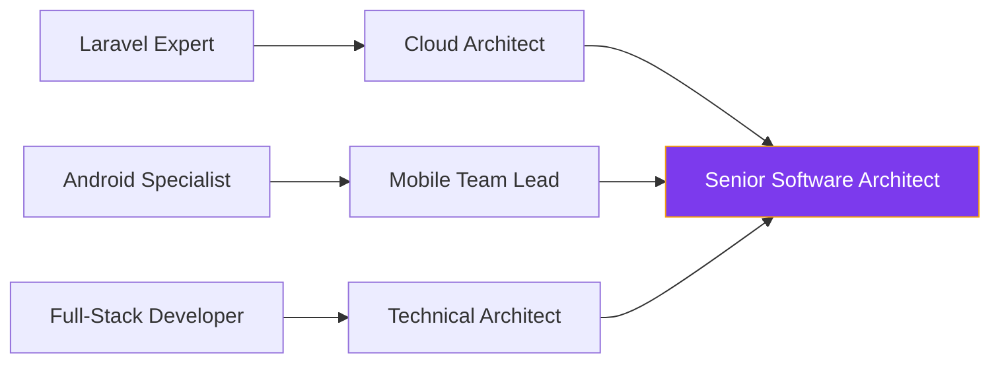

<div align="center">
  
# Hi there, I'm Ahmed Ibrahim 👋


</div>

---

## 🌟 About Me

<div align="center">

<table border="0" cellpadding="20" cellspacing="0">
<tr>
<td width="50%" valign="top" style="padding: 20px;">

<div align="left">

### 👨‍💻 **Who Am I?**

> 💡 **Passionate Full-Stack Developer** from Egypt 🇪🇬  
> 🎓 **Mathematics & Computer Science Graduate**  
> 🚀 **Specialized in Android Development & Backend Systems**  
> ⚙️ **Laravel & Spring Boot Expert**  

---

### 🎯 **What Drives Me?**

```yaml
passions:
  innovation: "Exploring cutting-edge technologies"
  architecture: "Building scalable solutions"
  design: "Crafting beautiful user experiences"
  collaboration: "Working with amazing teams"
  learning: "Continuous skill development"
```

### 🌟 **Core Values**

- **🔥 Quality First** → Writing clean, maintainable code
- **⚡ Performance Focused** → Optimized, efficient solutions  
- **🎨 User-Centric** → Intuitive, accessible design
- **📚 Growth Mindset** → Always learning, always improving
- **🤝 Team Player** → Collaborative problem solving

</div>

</td>
<td width="50%" valign="top" style="padding: 20px;">

<div align="center">


<br><br>

### 📊 **GitHub Analytics**


### ⚡ **Developer Insights**

<div align="left" style="padding: 10px;">

```javascript
const ahmed = {
  coffee: "☕ Essential fuel for coding",
  superpower: "🐛 Bug detection at 3 AM",
  philosophy: "💭 Code is poetry in logic",
  motto: "✨ Turning ideas into reality",
  workflow: "🔄 Test, Build, Deploy, Repeat"
};
```

</div>

</div>

</td>
</tr>
</table>

</div>

---

## 🚀 Tech Stack & Expertise

<div align="center">

### 📱 **Mobile Development Excellence**
<div style="padding: 15px;">


<br><br>


</div>

### ⚙️ **Backend & Systems Mastery**
<div style="padding: 15px;">


<br><br>


</div>

### 🗄️ **Database & Cloud Solutions**
<div style="padding: 15px;">


<br><br>


</div>

### 🎨 **Design & Development Tools**
<div style="padding: 15px;">


<br><br>


</div>

</div>

---

## 🌟 Featured Projects Showcase

<div align="center">

### 🚀 **Explore My Development Portfolio**

<table>
<tr>
<td width="50%" align="center" style="padding: 20px;">

<div style="border: 2px solid #7C3AED; border-radius: 10px; padding: 20px; background: linear-gradient(135deg, #1e1b4b 0%, #312e81 100%);">

### ✈️ **Flight Booking App**
*Modern flight booking solution with real-time search capabilities*

<br>

**🔧 Technology Stack:**  
`Kotlin` `Jetpack Compose` `MVVM` `REST API` `Firebase`

**✨ Key Features:**  
🔍 Real-time flight search & filtering  
💳 Secure payment integration (Stripe)  
🎨 Material Design 3 UI components  
📊 Booking analytics & history  

<br>

[🔗 **Explore Project**](https://github.com/ahmedabdalharith)

</div>

</td>
<td width="50%" align="center" style="padding: 20px;">

<div style="border: 2px solid #059669; border-radius: 10px; padding: 20px; background: linear-gradient(135deg, #064e3b 0%, #065f46 100%);">

### 🛒 **E-Commerce Platform**
*Complete shopping experience with comprehensive admin dashboard*

<br>

**🔧 Technology Stack:**  
`Laravel` `PHP` `MySQL` `Vue.js` `Redis`

**✨ Key Features:**  
📦 Dynamic product catalog with search  
🛒 Smart shopping cart & wishlist  
💰 Multi-payment gateway integration  
📈 Advanced analytics dashboard  

<br>

[🔗 **Explore Project**](https://github.com/ahmedabdalharith)

</div>

</td>
</tr>
<tr>
<td width="50%" align="center" style="padding: 20px;">

<div style="border: 2px solid #DC2626; border-radius: 10px; padding: 20px; background: linear-gradient(135deg, #7f1d1d 0%, #991b1b 100%);">

### 📚 **Learning Management System**
*Educational platform with interactive features and progress tracking*

<br>

**🔧 Technology Stack:**  
`Laravel` `PHP` `MySQL` `Bootstrap` `Chart.js`

**✨ Key Features:**  
📖 Interactive course management  
📅 Smart scheduling & assignments  
📊 Progress tracking & analytics  
🎥 Video streaming integration  

<br>

[🔗 **Explore Project**](https://github.com/ahmedabdalharith)

</div>

</td>
<td width="50%" align="center" style="padding: 20px;">

<div style="border: 2px solid #0891B2; border-radius: 10px; padding: 20px; background: linear-gradient(135deg, #164e63 0%, #155e75 100%);">

### 📖 **Quran Reader App**
*Beautiful Islamic application with audio recitation and translations*

<br>

**🔧 Technology Stack:**  
`Kotlin` `Room Database` `ExoPlayer` `Custom Views`

**✨ Key Features:**  
📜 Beautiful Arabic text rendering  
🔖 Smart bookmarks & notes  
🎵 High-quality audio recitations  
🌍 Multiple language translations  

<br>

[🔗 **Explore Project**](https://github.com/ahmedabdalharith)

</div>

</td>
</tr>
</table>

<br>

[](https://github.com/ahmedabdalharith?tab=repositories)

</div>

---

### 💻 **Technology Distribution & Expertise**

<table cellpadding="10" style="width: 100%;">
<tr>
<td width="60%" align="center">


</td>
<td width="40%" align="left" style="padding-left: 20px;">

**🎯 Language Expertise:**

```yaml
primary:
  backend: "PHP, Laravel"
  mobile: "Kotlin, Java"
  database: "MySQL, SQLite"
  
secondary:
  backend: "Spring Boot, Python"
  frontend: "JavaScript, Vue.js"
  systems: "C++"
```

**📊 Development Focus:**
- ⚙️ **40%** Backend Development (PHP/Laravel)
- 📱 **35%** Mobile Development (Kotlin/Android)  
- 🌐 **15%** Frontend Development
- 🎨 **10%** UI/UX & Design

</td>
</tr>
</table>

</div>

<br><br>

<div style="background: linear-gradient(135deg, #155e75 0%, #0891b2 100%); padding: 25px; border-radius: 12px; border: 1px solid #06b6d4;">

### 🏆 **Development Achievements & Metrics**

<table cellpadding="15" style="width: 100%;">
<tr>
<td width="25%" align="center">

<div style="background: rgba(0, 0, 0, 0.3); padding: 15px; border-radius: 8px;">

**📦 Repositories**
### 30+
*Active Projects*

</div>

</td>
<td width="25%" align="center">

<div style="background: rgba(0, 0, 0, 0.3); padding: 15px; border-radius: 8px;">

**⭐ Total Stars**
### 75+
*Community Recognition*

</div>

</td>
<td width="25%" align="center">

<div style="background: rgba(0, 0, 0, 0.3); padding: 15px; border-radius: 8px;">

**🔄 Contributions**
### 1200+
*This Year*

</div>

</td>
<td width="25%" align="center">

<div style="background: rgba(0, 0, 0, 0.3); padding: 15px; border-radius: 8px;">

**👥 Followers**
### 50+
*Developer Network*

</div>

</td>
</tr>
</table>

**🎯 Notable Achievements:**
- 🚀 **Consistent Contributor** - Active daily coding streak
- 💡 **Multi-language Developer** - Proficient in 7+ programming languages  
- 🏗️ **Full-stack Architect** - End-to-end solution expertise
- 📱 **Mobile & Backend Specialist** - Cross-platform development
- 🎨 **UI/UX Enthusiast** - Design-to-code implementation

</div>

</div>

### 📈 **Annual Growth Trajectory**

<div style="background: linear-gradient(90deg, #7c3aed 0%, #06b6d4 50%, #10b981 100%); padding: 3px; border-radius: 10px;">
<div style="background: #0d1117; padding: 15px; border-radius: 7px;">

```
2023 ████████░░ 80% (Learning & Foundation)
2024 ████████████░░ 90% (Building & Growth)  
2025 ████████████████ 100% (Leading & Innovation)
```

**Current Focus:** 🎯 Laravel mastery, Android Jetpack Compose, and cloud architecture  
**Next Milestone:** ⭐ Reach 100+ stars & lead major open source contributions

</div>
</div>

</div>

---

## 🎯 Development Journey & Roadmap

<div align="center">

<table>
<tr>
<td width="33%" align="center" style="padding: 20px;">

### 🚀 **Currently Building**

<div align="left">

```yaml
active_projects:
  mobile: "Jetpack Compose Applications"
  backend: "Laravel API Microservices"
  web: "Vue.js Admin Dashboards"
  architecture: "Clean Code Patterns"
  database: "Optimized Query Design"
```

</div>

</td>
<td width="33%" align="center" style="padding: 20px;">

### 📚 **Learning & Expanding**

<div align="left">

```yaml
skills_development:
  multiplatform: "Kotlin Multiplatform Mobile"
  cloud: "AWS & Docker Containers"
  frontend: "React.js & TypeScript"
  patterns: "Advanced System Design"
  security: "API Security Best Practices"
```

</div>

</td>
<td width="33%" align="center" style="padding: 20px;">

### 🎯 **2025 Goals & Vision**

<div align="left">

```yaml
objectives:
  publish: "5+ Mobile Apps to Play Store"
  contribute: "Major Open Source Projects"
  certify: "Laravel & AWS Certifications"
  mentor: "Developer Community Leader"
  freelance: "Global Client Success Stories"
```

</div>

</td>
</tr>
</table>

### 🛤️ **Professional Evolution Path**

<div style="background: linear-gradient(90deg, #1e1b4b 0%, #7c3aed 50%, #06b6d4 100%); padding: 2px; border-radius: 10px; margin: 20px 0;">
<div style="background: #0d1117; padding: 20px; border-radius: 8px;">

**Career Development Roadmap:**



</div>
</div>

</div>

---

## 🏆 GitHub Achievements & Recognition

<div align="center">


### 📊 **Contribution Activity**


</div>

---

## 💼 Professional Services & Expertise

<div align="center">

### 🤝 **Available for Collaboration**

<table>
<tr>
<td width="25%" align="center" style="padding: 15px;">

<div style="background: linear-gradient(135deg, #312e81 0%, #7c3aed 100%); padding: 20px; border-radius: 10px;">


**📱 Android Development**
- Kotlin & Jetpack Compose
- MVVM & Clean Architecture
- Material Design 3
- Play Store Optimization

</div>

</td>
<td width="25%" align="center" style="padding: 15px;">

<div style="background: linear-gradient(135deg, #065f46 0%, #059669 100%); padding: 20px; border-radius: 10px;">


**⚙️ Backend Development**
- Laravel & PHP Expertise
- RESTful API Design
- Database Optimization
- Microservices Architecture

</div>

</td>
<td width="25%" align="center" style="padding: 15px;">

<div style="background: linear-gradient(135deg, #991b1b 0%, #dc2626 100%); padding: 20px; border-radius: 10px;">


**🎨 Full-Stack Solutions**
- Frontend Development
- UI/UX Implementation
- Responsive Design
- Performance Optimization

</div>

</td>
<td width="25%" align="center" style="padding: 15px;">

<div style="background: linear-gradient(135deg, #155e75 0%, #0891b2 100%); padding: 20px; border-radius: 10px;">


**🔧 Technical Consulting**
- Code Architecture Review
- Performance Optimization
- Best Practices Training
- Team Leadership

</div>

</td>
</tr>
</table>

### 💰 **Professional Investment Rates**

<div style="background: linear-gradient(135deg, #1e1b4b 0%, #312e81 100%); padding: 20px; border-radius: 10px; margin: 20px 0;">

| **Service Category** | **Rate Range** | **Expertise Level** | **Delivery Quality** |
|:---:|:---:|:---:|:---:|
| 📱 **Mobile Development** | $18-28/hour | Senior Android | Production Ready |
| ⚙️ **Backend APIs (Laravel)** | $22-35/hour | Laravel Expert | Scalable Solutions |
| 🌐 **Full-Stack Projects** | $20-30/hour | End-to-End | Complete Solutions |
| 🔧 **Technical Leadership** | $30-40/hour | Architecture Expert | Strategic Guidance |

*Rates vary based on project complexity, timeline, and long-term partnership opportunities*

</div>

</div>

---

## 🤝 Let's Connect & Build the Future Together

<div align="center">

### 🌐 **Professional Network & Contact**

<div style="padding: 20px;">

<a href="https://www.linkedin.com/in/ahmed-ibrahim-466a05287" target="_blank">
  
</a>
<a href="https://github.com/ahmedabdalharith" target="_blank">
  
</a>
<a href="mailto:ahmed.alharith01@gmail.com">
  
</a>
<a href="#" target="_blank">
  
</a>
<a href="#" target="_blank">
  
</a>

</div>

### 💼 **Open for New Opportunities**

<table>
<tr>
<td align="center" style="padding: 15px;">
<div style="background: linear-gradient(135deg, #7c3aed 0%, #06b6d4 100%); padding: 15px; border-radius: 10px;">
<br>
<strong>Full-Time Positions</strong><br>
<small>Senior Laravel & Android Developer Roles</small>
</div>
</td>
<td align="center" style="padding: 15px;">
<div style="background: linear-gradient(135deg, #059669 0%, #10b981 100%); padding: 15px; border-radius: 10px;">
<br>
<strong>Freelance Projects</strong><br>
<small>Custom Mobile & Web Applications</small>
</div>
</td>
<td align="center" style="padding: 15px;">
<div style="background: linear-gradient(135deg, #dc2626 0%, #ef4444 100%); padding: 15px; border-radius: 10px;">
<br>
<strong>Open Source</strong><br>
<small>Community Contributions & Leadership</small>
</div>
</td>
<td align="center" style="padding: 15px;">
<div style="background: linear-gradient(135deg, #0891b2 0%, #0ea5e9 100%); padding: 15px; border-radius: 10px;">
<br>
<strong>Mentoring & Training</strong><br>
<small>Code Reviews & Technical Guidance</small>
</div>
</td>
</tr>
</table>

### 🎯 **What I'm Looking For:**

<div style="background: linear-gradient(135deg, #1e1b4b 0%, #7c3aed 50%, #06b6d4 100%); padding: 3px; border-radius: 10px; margin: 20px 0;">
<div style="background: #0d1117; padding: 20px; border-radius: 7px;">

- **🚀 Innovative Projects** that push the boundaries of technology
- **🤝 Collaborative Teams** that value clean code and best practices  
- **📱 Mobile-First Companies** building the next generation of apps
- **⚙️ Backend Challenges** requiring scalable, high-performance solutions
- **🌍 Global Remote Opportunities** with diverse, multicultural teams

</div>
</div>

</div>

---

<div align="center">


<div style="background: linear-gradient(135deg, #1e1b4b 0%, #7c3aed 50%, #06b6d4 100%); padding: 3px; border-radius: 10px; margin: 20px 0;">
<div style="background: #0d1117; padding: 20px; border-radius: 7px;">

### 💫 *"Great software isn't just code - it's poetry written in logic, solving real problems for real people."*

**☕ Developer's Philosophy:** I debug better with coffee ☕, code faster with music 🎵, and solve problems best when collaborating with amazing teams! 🤝

**🌟 Fun Fact:** I've written over 100,000 lines of code this year and I'm just getting started! 🔥

</div>
</div>


<br>


<br>

<div style="background: rgba(124, 58, 237, 0.1); padding: 15px; border-radius: 10px; border: 1px solid #7c3aed;">

**🎯 Current Status:** Actively seeking new opportunities | Open for freelance projects | Available for technical consultations

**📅 Last Updated:** September 2025 | Made with 💜, lots of ☕, and endless curiosity

</div>

</div>
