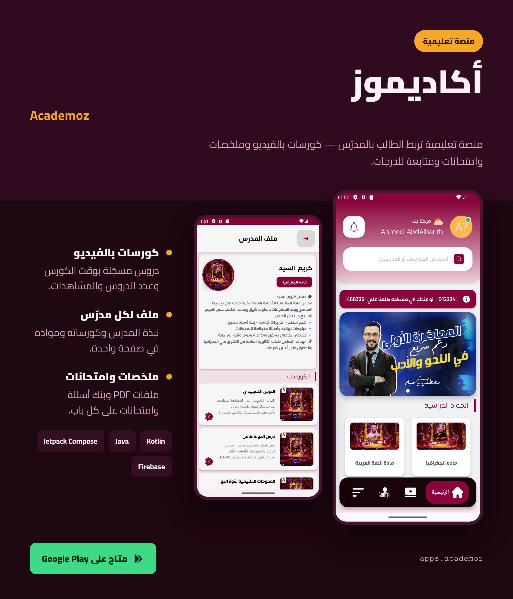
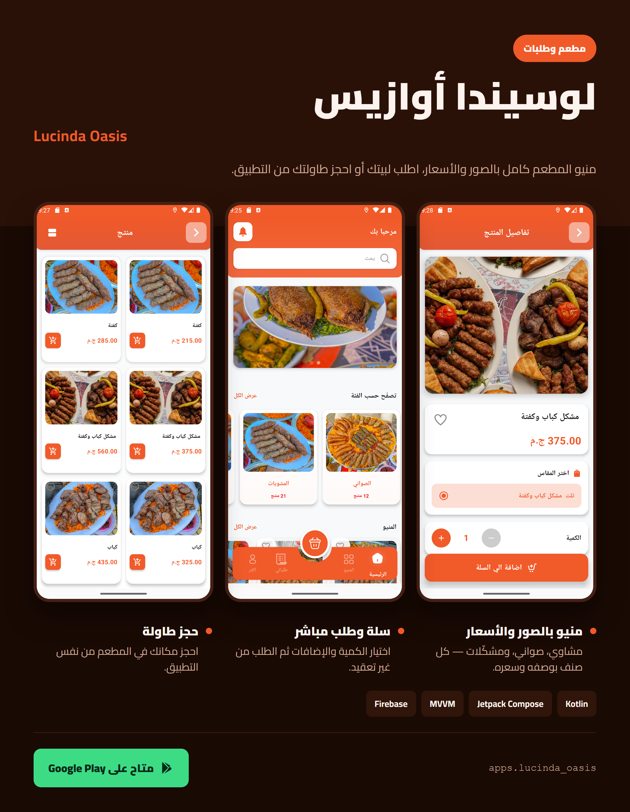
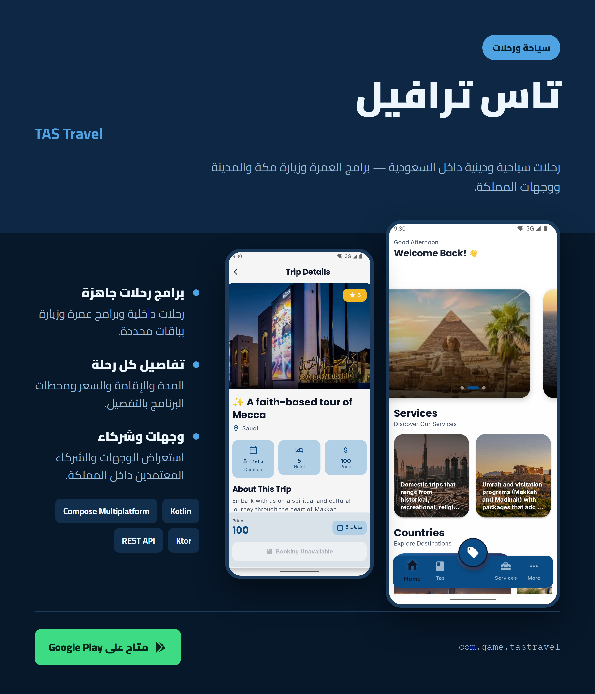
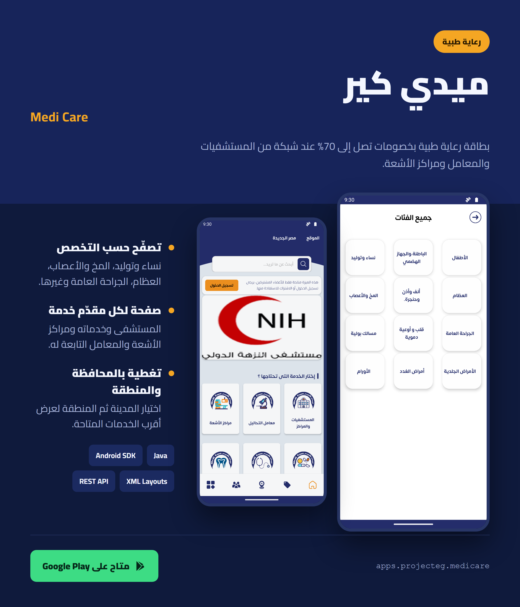
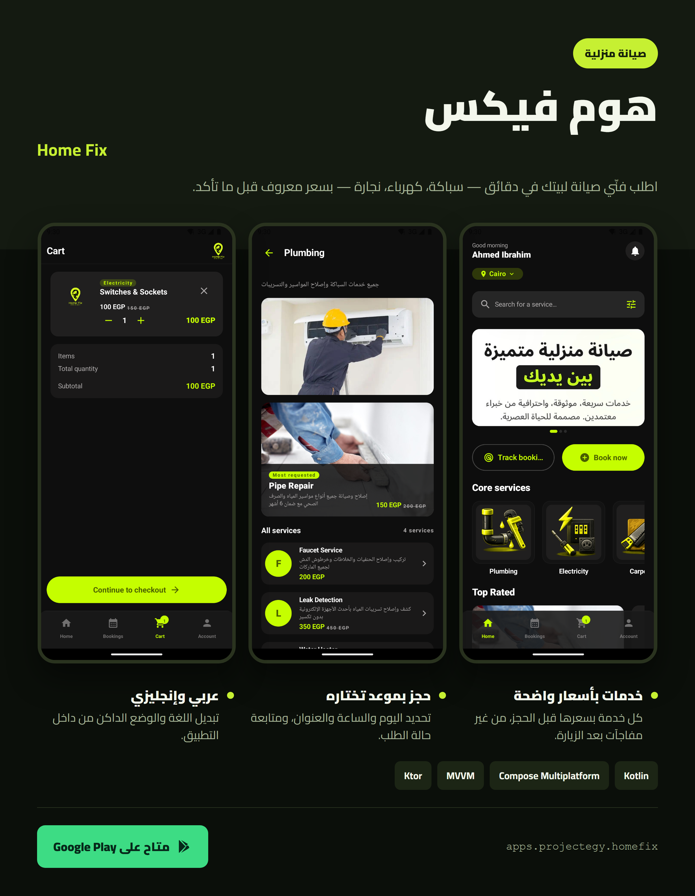
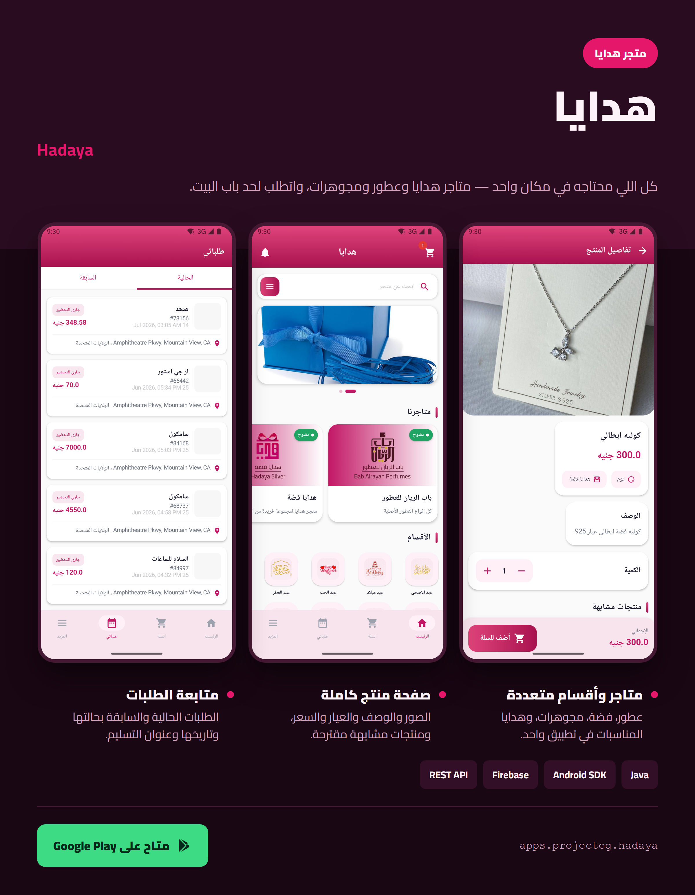
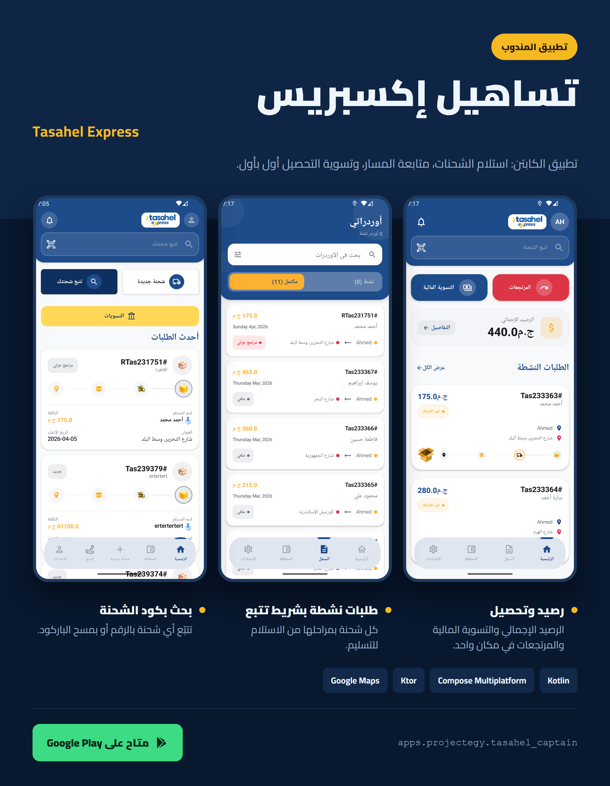
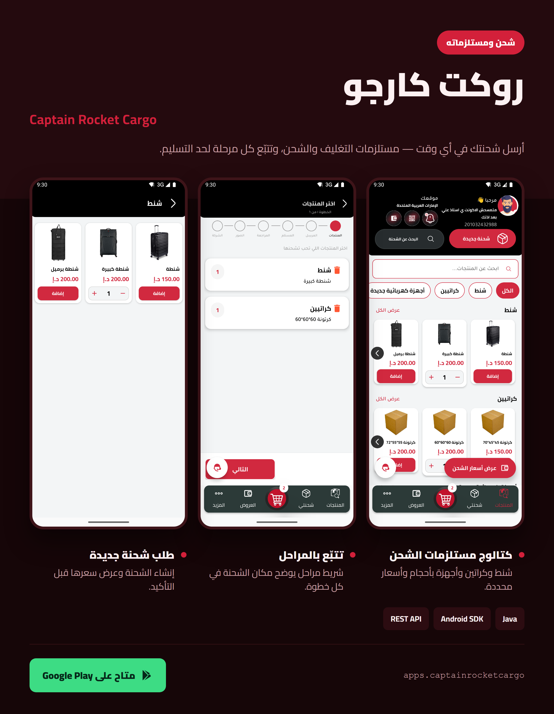
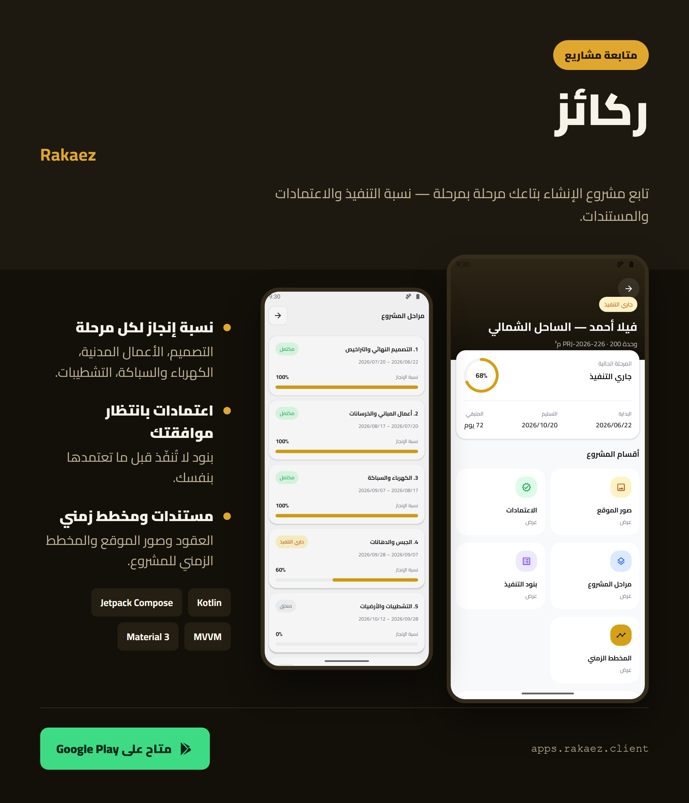

<div align="center">
  
# Hi there, I'm Ahmed Ibrahim 👋


</div>

---

## 🌟 About Me

<div align="center">


<table border="0" cellpadding="25" cellspacing="0" style="border-radius: 15px;">
<tr>
<td width="50%" valign="top" style="padding: 25px;">

<div align="left">

### 👨‍💻 **Who Am I?**


> 💡 **Passionate Mobile Developer** from Egypt 🇪🇬  
> 🎓 **Mathematics & Computer Science Graduate**  
> 🚀 **Specialized in Android & iOS Development**  
> 📱 **Kotlin & Java Enthusiast**  


### 🎯 **What Drives Me?**

```yaml
passions:
  innovation: "🔮 Exploring cutting-edge mobile technologies"
  architecture: "🏗️ Building scalable cross-platform solutions"
  design: "🎨 Crafting beautiful user experiences"
  collaboration: "🤝 Working with amazing teams"
  learning: "📚 Continuous skill development"
```

### 🌟 **Core Values**

<div style="background: linear-gradient(45deg, #667eea 0%, #764ba2 100%); padding: 15px; border-radius: 10px; color: white;">

- **🔥 Quality First** → Writing clean, maintainable code
- **⚡ Performance Focused** → Optimized, efficient solutions  
- **🎨 User-Centric** → Intuitive, accessible design
- **📚 Growth Mindset** → Always learning, always improving
- **🤝 Team Player** → Collaborative problem solving

</div>

</div>

</td>
<td width="50%" valign="top" style="padding: 25px;">

<div align="center">


<br><br>

### 📊 **GitHub Analytics**

<div style="background: linear-gradient(135deg, #667eea 0%, #764ba2 100%); padding: 20px; border-radius: 15px; box-shadow: 0 8px 32px 0 rgba(31, 38, 135, 0.37);">


</div>

### ⚡ **Developer Insights**

<div align="left" style="padding: 15px; background: linear-gradient(45deg, #1a1a2e, #16213e, #0f3460); border-radius: 10px;">

```javascript
const ahmed = {
  coffee: "☕ Essential fuel for coding",
  superpower: "🐛 Bug detection at 3 AM",
  philosophy: "💭 Code is poetry in logic",
  motto: "✨ Turning ideas into reality",
  workflow: "🔄 Test, Build, Deploy, Repeat"
};
```

</div>

</div>

</td>
</tr>
</table>


</div>

---

## 🚀 Tech Stack & Expertise

<div align="center">

### 📱 **Mobile Development Excellence**
<div style="background: linear-gradient(135deg, #667eea 0%, #764ba2 100%); padding: 25px; border-radius: 20px; margin: 15px 0; box-shadow: 0 8px 32px 0 rgba(31, 38, 135, 0.37);">


<br><br>

)
)
)
)
)
)
)
)
)

</div>

### ⚙️ **Backend Development**
<div style="background: linear-gradient(135deg, #f093fb 0%, #f5576c 100%); padding: 25px; border-radius: 20px; margin: 15px 0; box-shadow: 0 8px 32px 0 rgba(31, 38, 135, 0.37);">


<br><br>

)
)
)
)

</div>

### 🗄️ **Database & Cloud Solutions**
<div style="background: linear-gradient(135deg, #4facfe 0%, #00f2fe 100%); padding: 25px; border-radius: 20px; margin: 15px 0; box-shadow: 0 8px 32px 0 rgba(31, 38, 135, 0.37);">


<br><br>

)
)
)
)
)

</div>

### 🎨 **Design & Development Tools**
<div style="background: linear-gradient(135deg, #fa709a 0%, #fee140 100%); padding: 25px; border-radius: 20px; margin: 15px 0; box-shadow: 0 8px 32px 0 rgba(31, 38, 135, 0.37);">


<br><br>

)
)
)
)

</div>

</div>

---

## 🌟 Featured Projects Showcase

<div align="center">


### 🚀 **Published Apps on Google Play Store**

<table>
<tr>
<td width="50%" align="center" style="padding: 20px;">

<div style="background: linear-gradient(135deg, #667eea 0%, #764ba2 100%); border-radius: 20px; padding: 25px; box-shadow: 0 15px 35px rgba(102, 126, 234, 0.3); transform: perspective(1000px) rotateX(2deg); transition: all 0.3s ease;">

### 🎓 **Academoz - Educational Platform**
*Comprehensive learning platform connecting students with quality education*

<a href="assets/posters/academoz.png"></a>

**🔧 Technology Stack:**  
`Kotlin` `Java` `Jetpack Compose` `MVVM` `Firebase` `Material Design 3`

**✨ Key Features:**  
📚 Comprehensive course catalog  
🎥 Video streaming integration  
📊 Progress tracking & analytics  
💬 Interactive learning tools  

<br>

[](https://play.google.com/store/apps/details?id=apps.academoz)

</div>

</td>
<td width="50%" align="center" style="padding: 20px;">

<div style="background: linear-gradient(135deg, #f093fb 0%, #f5576c 100%); border-radius: 20px; padding: 25px; box-shadow: 0 15px 35px rgba(240, 147, 251, 0.3); transform: perspective(1000px) rotateX(2deg); transition: all 0.3s ease;">

### 📖 **Al-Rowadh Education**
*Islamic educational app with structured learning curriculum*


**🔧 Technology Stack:**  
`Kotlin` `XML` `Room Database` `MVP` `Material Design 3`

**✨ Key Features:**  
📱 Beautiful, intuitive interface  
🔖 Smart bookmarking system  
📊 Learning progress dashboard  
🌙 Dark mode support  

<br>

[](https://play.google.com/store/apps/details?id=apps.eduction_alrowadh)

</div>

</td>
</tr>
<tr>
<td width="50%" align="center" style="padding: 20px;">

<div style="background: linear-gradient(135deg, #4facfe 0%, #00f2fe 100%); border-radius: 20px; padding: 25px; box-shadow: 0 15px 35px rgba(79, 172, 254, 0.3); transform: perspective(1000px) rotateX(2deg); transition: all 0.3s ease;">

### 🍽️ **Lucinda Oasis Restaurant**
*Modern restaurant ordering app with seamless payment integration*

<a href="assets/posters/lucinda.png"></a>

**🔧 Technology Stack:**  
`Kotlin` `Jetpack Compose` `MVVM` `Firebase` `Stripe Payment`

**✨ Key Features:**  
🍔 Dynamic menu with images  
🛒 Smart cart management  
💳 Secure payment gateway (Stripe)  
📍 Location-based services  
🔔 Real-time order notifications  

<br>

[](https://play.google.com/store/apps/details?id=apps.lucinda_oasis)

</div>

</td>
<td width="50%" align="center" style="padding: 20px;">

<div style="background: linear-gradient(135deg, #fa709a 0%, #fee140 100%); border-radius: 20px; padding: 25px; box-shadow: 0 15px 35px rgba(250, 112, 154, 0.3); transform: perspective(1000px) rotateX(2deg); transition: all 0.3s ease;">

### ✈️ **TAS Travel - Flight Booking**
*Complete travel booking solution with real-time flight search*

<a href="assets/posters/tastravel.png"></a>

**🔧 Technology Stack:**  
`Kotlin` `Compose Multiplatform` `MVVM` `REST API` `Ktor`

**✨ Key Features:**  
🔍 Advanced flight search & filters  
✈️ Multi-city booking support  
💼 Booking history & management  
🎫 Digital ticket storage  
🌍 Multi-currency support  

<br>

[](https://play.google.com/store/apps/details?id=com.game.tastravel)

</div>

</td>
</tr>
<tr>
<td width="50%" align="center" style="padding: 20px;">

<div style="background: linear-gradient(135deg, #30cfd0 0%, #330867 100%); border-radius: 20px; padding: 25px; box-shadow: 0 15px 35px rgba(48, 207, 208, 0.3); transform: perspective(1000px) rotateX(2deg); transition: all 0.3s ease;">

### 🏥 **Medi Care — ميدي كير**
*Medical care membership with discounts across partner clinics and labs*

<a href="assets/posters/medicare.png"></a>

**🔧 Technology Stack:**  
`Java` `Android SDK` `XML Layouts` `REST API` `Material Design`

**✨ Key Features:**  
🏷️ Discounts of up to 70% on partner services  
🗺️ Governorate and district coverage picker  
👤 Membership registration & renewal  
👁️ Guest browsing before sign-up  

<br>

[](https://play.google.com/store/apps/details?id=apps.projecteg.medicare)

</div>

</td>
<td width="50%" align="center" style="padding: 20px;">

<div style="background: linear-gradient(135deg, #f6d365 0%, #fda085 100%); border-radius: 20px; padding: 25px; box-shadow: 0 15px 35px rgba(253, 160, 133, 0.3); transform: perspective(1000px) rotateX(2deg); transition: all 0.3s ease;">

### 🛠️ **Home Fix — هوم فيكس**
*On-demand home maintenance: request a technician, track the visit*

<a href="assets/posters/homefix.png"></a>

**🔧 Technology Stack:**  
`Kotlin` `Compose Multiplatform` `MVVM` `Ktor` `Koin`

**✨ Key Features:**  
🧰 Service catalog by trade  
📅 Visit scheduling & status tracking  
📍 Address book with map selection  
🌐 Arabic / English with full RTL  

<br>

[](https://play.google.com/store/apps/details?id=apps.projectegy.homefix)

</div>

</td>
</tr>
<tr>
<td width="50%" align="center" style="padding: 20px;">

<div style="background: linear-gradient(135deg, #ff9a9e 0%, #fecfef 100%); border-radius: 20px; padding: 25px; box-shadow: 0 15px 35px rgba(255, 154, 158, 0.3); transform: perspective(1000px) rotateX(2deg); transition: all 0.3s ease;">

### 🎁 **Hadaya — هدايا**
*Gift shopping and delivery with occasion-based browsing*

<a href="assets/posters/hadaya.png"></a>

**🔧 Technology Stack:**  
`Java` `Android SDK` `XML Layouts` `Firebase` `REST API`

**✨ Key Features:**  
🎀 Catalog organised by occasion  
🛒 Cart with gift notes  
🔔 Firebase push notifications  
🚚 Order tracking to delivery  

<br>

[](https://play.google.com/store/apps/details?id=apps.projecteg.hadaya)

</div>

</td>
<td width="50%" align="center" style="padding: 20px;">

<div style="background: linear-gradient(135deg, #43e97b 0%, #38f9d7 100%); border-radius: 20px; padding: 25px; box-shadow: 0 15px 35px rgba(67, 233, 123, 0.3); transform: perspective(1000px) rotateX(2deg); transition: all 0.3s ease;">

### 🛵 **Tasahel Express — تساهيل إكسبريس**
*Courier app for assigning, running and closing delivery trips*

<a href="assets/posters/tasahel.png"></a>

**🔧 Technology Stack:**  
`Kotlin` `Compose Multiplatform` `MVVM` `Ktor` `Google Maps`

**✨ Key Features:**  
📦 Trip queue with accept / reject  
🗺️ Navigation to pickup and drop-off  
💵 Cash-on-delivery reconciliation  
📈 Earnings and trip history  

<br>

[](https://play.google.com/store/apps/details?id=apps.projectegy.tasahel_captain)

</div>

</td>
</tr>
<tr>
<td width="50%" align="center" style="padding: 20px;">

<div style="background: linear-gradient(135deg, #5ee7df 0%, #b490ca 100%); border-radius: 20px; padding: 25px; box-shadow: 0 15px 35px rgba(94, 231, 223, 0.3); transform: perspective(1000px) rotateX(2deg); transition: all 0.3s ease;">

### 🚚 **Captain Rocket Cargo**
*Driver app for freight pickups, loads and proof of delivery*

<a href="assets/posters/rocketcargo.png"></a>

**🔧 Technology Stack:**  
`Java` `Android SDK` `XML Layouts` `REST API` `Google Maps`

**✨ Key Features:**  
🧾 Shipment list with load details  
📍 Live route to pickup and delivery  
📷 Proof-of-delivery capture  
🕒 Status updates per leg  

<br>

[](https://play.google.com/store/apps/details?id=apps.captainrocketcargo)

</div>

</td>
<td width="50%" align="center" style="padding: 20px;">

<div style="background: linear-gradient(135deg, #a18cd1 0%, #fbc2eb 100%); border-radius: 20px; padding: 25px; box-shadow: 0 15px 35px rgba(161, 140, 209, 0.3); transform: perspective(1000px) rotateX(2deg); transition: all 0.3s ease;">

### 🏗️ **Rakaez — ركائز**
*Construction project tracking for clients following their build*

<a href="assets/posters/rakaez.png"></a>

**🔧 Technology Stack:**  
`Kotlin` `Jetpack Compose` `MVVM` `REST API` `Material Design 3`

**✨ Key Features:**  
📊 Stage-by-stage progress view  
🖼️ Site photo updates per milestone  
📄 Documents and contract access  
🔔 Progress notifications  

<br>

[](https://play.google.com/store/apps/details?id=apps.rakaez.client)

</div>

</td>
</tr>
</table>

<br>

<div style="background: linear-gradient(135deg, #667eea 0%, #764ba2 100%); padding: 20px; border-radius: 15px; margin: 20px 0;">

[](https://github.com/ahmedabdalharith?tab=repositories)

</div>

</div>

---

### 💻 **Technology Distribution & Expertise**

<div align="center">


<table cellpadding="15" style="width: 100%;">
<tr>
<td width="60%" align="center">

<div style="background: linear-gradient(135deg, #667eea 0%, #764ba2 100%); padding: 20px; border-radius: 15px; box-shadow: 0 8px 32px 0 rgba(31, 38, 135, 0.37);">


</div>

</td>
<td width="40%" align="left" style="padding-left: 25px;">

<div style="background: linear-gradient(135deg, #4facfe 0%, #00f2fe 100%); padding: 20px; border-radius: 15px; box-shadow: 0 8px 32px 0 rgba(31, 38, 135, 0.37);">

**🎯 Language Expertise:**

```yaml
primary:
  mobile: "Kotlin, Java"
  cross_platform: "Compose Multiplatform"
  backend: "PHP, Laravel"
  database: "MySQL, SQLite, Room"
  
secondary:
  backend: "Spring Boot, Python"
  patterns: "MVVM, MVP"
  systems: "REST API"
```

**📊 Development Focus:**
- 📱 **50%** Android Development
- 🍎 **20%** iOS (Compose Multiplatform)  
- ⚙️ **20%** Backend Development
- 🎨 **10%** UI/UX & Design

</div>

</td>
</tr>
</table>


</div>

<br><br>

<div style="background: linear-gradient(135deg, #f093fb 0%, #f5576c 100%); padding: 30px; border-radius: 20px; box-shadow: 0 15px 35px rgba(240, 147, 251, 0.3);">

### 🏆 **Development Achievements & Metrics**


<table cellpadding="20" style="width: 100%;">
<tr>
<td width="25%" align="center">

<div style="background: rgba(255, 255, 255, 0.2); padding: 20px; border-radius: 15px; backdrop-filter: blur(10px);">

**📦 Repositories**
### 30+
*Active Projects*

</div>

</td>
<td width="25%" align="center">

<div style="background: rgba(255, 255, 255, 0.2); padding: 20px; border-radius: 15px; backdrop-filter: blur(10px);">

**⭐ Total Stars**
### 75+
*Community Recognition*

</div>

</td>
<td width="25%" align="center">

<div style="background: rgba(255, 255, 255, 0.2); padding: 20px; border-radius: 15px; backdrop-filter: blur(10px);">

**🔄 Contributions**
### 1200+
*This Year*

</div>

</td>
<td width="25%" align="center">

<div style="background: rgba(255, 255, 255, 0.2); padding: 20px; border-radius: 15px; backdrop-filter: blur(10px);">

**📱 Published Apps**
### 4+
*Play Store*

</div>

</td>
</tr>
</table>

**🎯 Notable Achievements:**
- 🚀 **Published Developer** - 4+ apps on Google Play Store
- 💡 **Multi-language Developer** - Kotlin, Java, PHP proficiency  
- 🏗️ **Full-Stack Capable** - Mobile to Backend expertise
- 📱 **Cross-Platform Specialist** - Android & iOS development
- 🎨 **UI/UX Implementer** - Design-to-code excellence

</div>

</div>

### 📈 **Annual Growth Trajectory**

<div align="center">

<div style="background: linear-gradient(90deg, #667eea 0%, #764ba2 50%, #f093fb 100%); padding: 5px; border-radius: 15px; margin: 20px 0;">
<div style="background: #1a1a2e; padding: 20px; border-radius: 10px;">


```
2023 ████████████░░░░ 75% (Learning & Foundation)
2024 ████████████████░░ 90% (Building & Publishing)  
2025 ████████████████████ 100% (Cross-Platform Mastery)
```

**Current Focus:** 🎯 Compose Multiplatform, Laravel mastery, and advanced mobile architecture  
**Next Milestone:** ⭐ 10+ published apps & full-stack mobile solutions

</div>
</div>

</div>

</div>

---

## 🎯 Development Journey & Roadmap

<div align="center">


<table>
<tr>
<td width="33%" align="center" style="padding: 25px;">

<div style="background: linear-gradient(135deg, #667eea 0%, #764ba2 100%); padding: 25px; border-radius: 20px; box-shadow: 0 8px 32px 0 rgba(31, 38, 135, 0.37);">

### 🚀 **Currently Building**


<div align="left">

```yaml
active_projects:
  mobile: "Jetpack Compose Apps"
  ios: "Compose Multiplatform"
  backend: "Laravel API Services"
  architecture: "MVVM & MVP Patterns"
  ui_ux: "Material Design 3"
```

</div>

</div>

</td>
<td width="33%" align="center" style="padding: 25px;">

<div style="background: linear-gradient(135deg, #4facfe 0%, #00f2fe 100%); padding: 25px; border-radius: 20px; box-shadow: 0 8px 32px 0 rgba(31, 38, 135, 0.37);">

### 📚 **Learning & Expanding**


<div align="left">

```yaml
skills_development:
  multiplatform: "Kotlin Multiplatform Mobile"
  backend: "Spring Boot Microservices"
  advanced: "Advanced Compose Patterns"
  patterns: "System Design"
  cloud: "AWS & Docker"
```

</div>

</div>

</td>
<td width="33%" align="center" style="padding: 25px;">

<div style="background: linear-gradient(135deg, #fa709a 0%, #fee140 100%); padding: 25px; border-radius: 20px; box-shadow: 0 8px 32px 0 rgba(31, 38, 135, 0.37);">

### 🎯 **2025 Goals & Vision**


<div align="left">

```yaml
objectives:
  publish: "10+ Mobile Apps"
  master: "Compose Multiplatform"
  backend: "Laravel & Spring Boot"
  contribute: "Open Source Projects"
  mentor: "Developer Community"
```

</div>

</div>

</td>
</tr>
</table>

### 🛤️ **Professional Evolution Path**

<div style="background: linear-gradient(135deg, #667eea 0%, #764ba2 50%, #f093fb 100%); padding: 5px; border-radius: 15px; margin: 25px 0;">
<div style="background: #1a1a2e; padding: 25px; border-radius: 10px;">

**Career Development Roadmap:**


```
🚀 Mobile Developer ─────► 📱 Mobile Architect
⚙️ Backend Developer ────► 👨‍💼 Full-Stack Lead  
💻 Cross-Platform Dev ───► 🎯 Technical Architect
                          │
                          └──► 🌟 Senior Software Architect
```

</div>
</div>

</div>

---

## 🏆 GitHub Achievements & Recognition

<div align="center">

<div style="background: linear-gradient(135deg, #667eea 0%, #764ba2 100%); padding: 25px; border-radius: 20px; margin: 20px 0; box-shadow: 0 8px 32px 0 rgba(31, 38, 135, 0.37);">


</div>

### 📊 **Contribution Activity**

<div style="background: linear-gradient(135deg, #4facfe 0%, #00f2fe 100%); padding: 20px; border-radius: 15px; box-shadow: 0 8px 32px 0 rgba(31, 38, 135, 0.37);">


</div>

</div>

---

## 💼 Professional Services & Expertise

<div align="center">


### 🤝 **Available for Collaboration**

<table>
<tr>
<td width="25%" align="center" style="padding: 20px;">

<div style="background: linear-gradient(135deg, #667eea 0%, #764ba2 100%); padding: 25px; border-radius: 20px; box-shadow: 0 8px 32px 0 rgba(31, 38, 135, 0.37); transition: transform 0.3s ease;">


**📱 Android Development**
- Kotlin & Java
- Jetpack Compose & XML
- MVVM & MVP Architecture
- Play Store Publishing

</div>

</td>
<td width="25%" align="center" style="padding: 20px;">

<div style="background: linear-gradient(135deg, #f093fb 0%, #f5576c 100%); padding: 25px; border-radius: 20px; box-shadow: 0 8px 32px 0 rgba(31, 38, 135, 0.37); transition: transform 0.3s ease;">


**⚙️ Backend Development**
- Laravel & PHP
- Spring Boot & Java
- RESTful API Design
- Database Optimization

</div>

</td>
<td width="25%" align="center" style="padding: 20px;">

<div style="background: linear-gradient(135deg, #4facfe 0%, #00f2fe 100%); padding: 25px; border-radius: 20px; box-shadow: 0 8px 32px 0 rgba(31, 38, 135, 0.37); transition: transform 0.3s ease;">


**🌍 Cross-Platform**
- Compose Multiplatform
- Android & iOS Apps
- Shared Business Logic
- App Store Publishing

</div>

</td>
<td width="25%" align="center" style="padding: 20px;">

<div style="background: linear-gradient(135deg, #fa709a 0%, #fee140 100%); padding: 25px; border-radius: 20px; box-shadow: 0 8px 32px 0 rgba(31, 38, 135, 0.37); transition: transform 0.3s ease;">


**🔧 Technical Consulting**
- Code Architecture Review
- Performance Optimization
- Best Practices Training
- Team Leadership

</div>

</td>
</tr>
</table>

### 💰 **Professional Investment Rates**

<div style="background: linear-gradient(135deg, #667eea 0%, #764ba2 100%); padding: 25px; border-radius: 20px; margin: 25px 0; box-shadow: 0 8px 32px 0 rgba(31, 38, 135, 0.37);">


| **Service Category** | **Rate Range** | **Expertise Level** | **Delivery Quality** |
|:---:|:---:|:---:|:---:|
| 📱 **Mobile Development** | $18-28/hour | Senior Android | Production Ready |
| ⚙️ **Backend APIs** | $22-35/hour | Laravel & Spring | Scalable Solutions |
| 🌐 **Cross-Platform** | $25-35/hour | Compose KMP | Multi-Platform |
| 🔧 **Technical Leadership** | $30-40/hour | Architecture | Strategic Guidance |

*Rates vary based on project complexity, timeline, and long-term partnership opportunities*

</div>

</div>

---

## 🤝 Let's Connect & Build the Future Together

<div align="center">


### 🌐 **Professional Network & Contact**

<div style="background: linear-gradient(135deg, #667eea 0%, #764ba2 100%); padding: 25px; border-radius: 20px; margin: 20px 0; box-shadow: 0 8px 32px 0 rgba(31, 38, 135, 0.37);">

<a href="https://www.linkedin.com/in/ahmed-ibrahim-466a05287" target="_blank">
  
</a>
<a href="https://github.com/ahmedabdalharith" target="_blank">
  
</a>
<a href="mailto:ahmed.alharith01@gmail.com">
  
</a>
<a href="#" target="_blank">
  
</a>
<a href="#" target="_blank">
  
</a>

</div>

### 💼 **Open for New Opportunities**

<table>
<tr>
<td align="center" style="padding: 20px;">
<div style="background: linear-gradient(135deg, #667eea 0%, #764ba2 100%); padding: 20px; border-radius: 15px; box-shadow: 0 8px 32px 0 rgba(31, 38, 135, 0.37);">
<br>
<strong>Full-Time Positions</strong><br>
<small>Senior Mobile & Backend Roles</small>
</div>
</td>
<td align="center" style="padding: 20px;">
<div style="background: linear-gradient(135deg, #f093fb 0%, #f5576c 100%); padding: 20px; border-radius: 15px; box-shadow: 0 8px 32px 0 rgba(31, 38, 135, 0.37);">
<br>
<strong>Freelance Projects</strong><br>
<small>Custom Mobile & Backend Apps</small>
</div>
</td>
<td align="center" style="padding: 20px;">
<div style="background: linear-gradient(135deg, #4facfe 0%, #00f2fe 100%); padding: 20px; border-radius: 15px; box-shadow: 0 8px 32px 0 rgba(31, 38, 135, 0.37);">
<br>
<strong>Open Source</strong><br>
<small>Community Contributions</small>
</div>
</td>
<td align="center" style="padding: 20px;">
<div style="background: linear-gradient(135deg, #fa709a 0%, #fee140 100%); padding: 20px; border-radius: 15px; box-shadow: 0 8px 32px 0 rgba(31, 38, 135, 0.37);">
<br>
<strong>Mentoring</strong><br>
<small>Code Reviews & Guidance</small>
</div>
</td>
</tr>
</table>

### 🎯 **What I'm Looking For:**

<div style="background: linear-gradient(135deg, #667eea 0%, #764ba2 50%, #f093fb 100%); padding: 5px; border-radius: 15px; margin: 25px 0;">
<div style="background: #1a1a2e; padding: 25px; border-radius: 10px;">


- **🚀 Innovative Mobile Projects** pushing boundaries of technology
- **🤝 Collaborative Teams** valuing clean code and best practices  
- **📱 Cross-Platform Companies** building next-gen mobile apps
- **🌍 Global Remote Opportunities** with diverse teams
- **💡 Full-Stack Positions** combining mobile and backend expertise

</div>
</div>

</div>

---

<div align="center">


<div style="background: linear-gradient(135deg, #667eea 0%, #764ba2 50%, #f093fb 100%); padding: 5px; border-radius: 20px; margin: 25px 0;">
<div style="background: #1a1a2e; padding: 30px; border-radius: 15px;">


**🌟 Fun Fact:** I've written over 100,000 lines of code this year and I'm just getting started! 🔥

</div>
</div>

<div style="background: linear-gradient(135deg, #4facfe 0%, #00f2fe 100%); padding: 20px; border-radius: 15px; margin: 20px 0; box-shadow: 0 8px 32px 0 rgba(31, 38, 135, 0.37);">


</div>

<br>

<div style="background: linear-gradient(135deg, #667eea 0%, #764ba2 100%); padding: 20px; border-radius: 15px; box-shadow: 0 8px 32px 0 rgba(31, 38, 135, 0.37);">


</div>

<br>

<div style="background: linear-gradient(135deg, #fa709a 0%, #fee140 100%); padding: 20px; border-radius: 15px; border: 3px solid #667eea; box-shadow: 0 8px 32px 0 rgba(31, 38, 135, 0.37);">

**🎯 Current Status:** Actively seeking opportunities | Open for freelance | Available for consultations

**📅 Last Updated:** December 2025 | Made with 💜, lots of ☕, and endless passion

</div>


</div>
